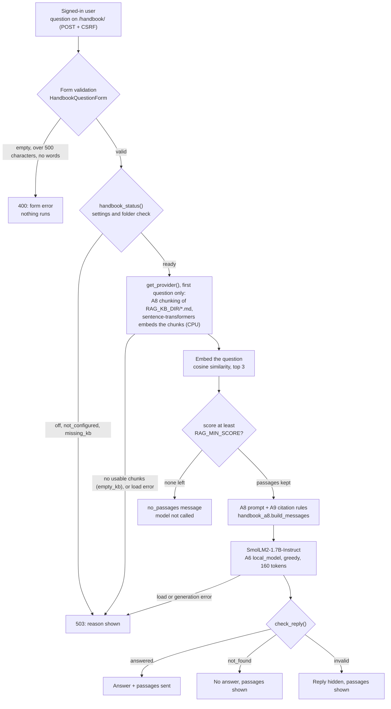

# DataPact: AI features (A6 and A9)

INFO 490 MG, Team 15. The A6 violation explainer is documented first (Route A,
prompt engineering). The A9 handbook Q&A is documented in its own section at
the end: [A9: Handbook Q&A](#a9-handbook-qa).

| Part | What | Where |
| --- | --- | --- |
| 1 | 15-model benchmark and Route A prompting | `llm-test/ai_prototype.ipynb`, results in `llm-test/results_light/` |
| 1 (follow-up) | 4 larger models (3.1B to 7.6B), same test | `llm-test/ai_prototype_3b_plus.ipynb`, results in `llm-test/results_3b_plus/` |
| 2.2 | Local Hugging Face model in a Django view | `data_quality/ai/` (`prompts.py`, `local_model.py`, `explain.py`), `data_quality/ai_views.py` |
| 2.3 | Second AI feature through an external API (Groq) | `data_quality/ai/groq_client.py`, same view and page |
| 3 | Production reflection | `docs/notes/notes.txt`, section "A6 - PART 3" |

## What the feature does

When a data file fails a contract rule, someone has to decide whether **the data
is wrong** or **the contract is out of date**. On a violation's page
(`/violations/<id>/explain/`), a signed-in user can ask a model for:

```json
{"explanation": "<one plain-English sentence>",
 "likely_cause": "DATA_ISSUE" | "CONTRACT_UPDATED",
 "suggested_action": "<one short sentence>"}
```

There are two engines, each with its own button when this server has it set
up:

* **Explain with AI**: `HuggingFaceTB/SmolLM2-1.7B-Instruct`, running in the
  Django process. The benchmark chose it: with the few-shot prompt (3 examples)
  it was the only result in the main benchmark (15 models zero-shot, then
  the top 3 with all four methods) with 8/8 valid replies and 8/8 correct
  causes. In the later 3B+ run, the 4
  larger models scored 4-6/8 on that same prompt; only Qwen2.5-7B matched
  8/8, and only with 12 examples and about 4 times the GPU memory (see
  `docs/notes/notes.txt`, section 48).
* **Explain with Groq (external API)**: the same prompt sent to Groq's hosted
  `openai/gpt-oss-20b` (or `GROQ_MODEL`), with fewer sample values (see
  "What is sent to Groq" below). This needs no GPU, so it also works on a
  small host where the local model is off.

Both buttons post to the same page (`engine=local` or `engine=groq`), and
both replies go through the same checks. On the production default (local
model off, Groq key set) only the Groq button is shown.

What the page says about each engine (UX Stage 2):

* **Before a click**, it shows a button only for an engine this server has
  set up: the local model switched on (`AI_LOCAL_ENABLED`), or a
  `GROQ_API_KEY` present. An engine that is not set up is shown as a
  disabled label with the reason ("The local model is switched off on this
  server."). This comes from settings alone: looking at the page never loads
  the model or contacts Groq, so "set up" is not a promise that the engine
  will answer.
* **While waiting**, a small script in the page writes what it is waiting
  for into a `role="status"` line ("Asking Groq… DataPact waits up to 20
  seconds for an answer.") and ignores a second click. If the visitor stops
  the request, the buttons unlock again after the longest the server should
  take (Groq's limit plus 10 seconds; 3 minutes for the local model).
  Without JavaScript the page works as before.
* **After a click**, the browser jumps to the answer (`#ai-suggestion`). A
  failure says which of these happened: the engine is not set up, Groq did
  not answer in time, Groq could not be reached, Groq's rate limit, or an
  error. "Try again" is offered only when trying again can help, and the
  other engine is offered when this server has it set up. A reply that fails
  the checks is not offered again from the same engine, since the same
  prompt most likely gets the same reply.

To get there: sign in, open **Contract search**, look up a dataset (for example
"Enrollment") under "Look up violations", and click **Explain**.

## Workflow

### Data input

1. A dataset is registered on the **Manage** page (`/datasets/manage/`, `DatasetForm`).
2. Its contract and validation rules (column, rule type, parameters such as
   `{"min": 0, "max": 24}`) are kept in the database and edited in the Django
   admin.
3. Each check of a file is a `ValidationRun`. Each rule it failed is a
   `Violation`, holding the failed-row count, up to a few sample values
   (`[{"row": 118, "value": -3}, ...]`) and a resolution that a person sets.
   The demo data comes from `python manage.py seed_demo`.

The AI never reads a raw file. It reads one stored `Violation` and its rule.

### Preprocessing (`data_quality/ai/prompts.py`)

The violation becomes the same five lines the benchmark tested:

```
Dataset: Monthly Enrollment Export
Column: credit_hours
Rule: RANGE {"min": 0, "max": 24}
Rows failed: 47 of 4,812 rows
Sample values: [-3, -1, -12]
```

Before it is used:

* The rule is written the way the notebook's examples write it
  (`format_rule`). Parameters that are not a JSON object count as no parameters.
* ASCII control characters in names and rule text (`\x00`-`\x1f` and
  `\x7f`, so newlines, carriage returns and tabs) become spaces, so a dataset
  or column name cannot add a fake line such as "Rule: ..." with an ordinary
  newline. A test checks `\n` and `\r\n`. Unicode line breaks (U+0085,
  U+2028, U+2029) are **not** replaced, so a name containing one could still
  look like a new line to a model.
* Lengths are capped: names at 120 characters, rules at 300.
* At most 5 sample values are used, each cut to 60 characters with ASCII
  control characters removed. They are then written as a JSON list, which
  escapes any other line break (U+2028 becomes `
`). Row numbers are
  dropped. Entries with no value are
  skipped, so the model never sees a null that was not recorded.
* The instructions, the 3 examples and the message layout are copied
  verbatim from the notebook, and a test (`PromptMatchesBenchmarkTests`)
  fails if they drift.

### What is sent to Groq (`data_quality/ai/groq_client.py`)

The local model sees up to 5 cleaned sample values. Groq sees the same
prompt with a much stricter `Sample values:` line.

Always sent:

* The fixed instructions and the 3 worked examples from the notebook (made-up
  data, not ours).
* The **dataset name**, the **column name** and the **rule as written in the
  contract**, which includes an ALLOWED_VALUES list, a REGEX pattern or a
  RANGE's numbers. These come from whoever set up the contract, not from the
  file. They get the same cleaning as for the local model (ASCII control
  characters, newlines included, become spaces; names cut at 120 characters,
  the rule at 300) and are otherwise
  sent as written. A contract that lists names or IDs in its rule would
  send them.
* The failed-row count, e.g. `47 of 4,812 rows`.

Values from the file are sent only when all of these hold:

* the rule is `ALLOWED_VALUES` or `TYPE_MATCH`;
* the value is text (never a number), plain ASCII, and at most 20 characters;
* ignoring case and surrounding spaces, it is one of these status words
  (`SAFE_CODES`): ACTIVE, INACTIVE, PENDING, APPROVED, REJECTED, CANCELLED,
  CANCELED, OPEN, CLOSED, COMPLETE, COMPLETED, ENROLLED, DROPPED, WITHDRAWN,
  AUDIT, LOW, MEDIUM, HIGH, CRITICAL, URGENT, YES, NO, Y, N, TRUE, FALSE, NA,
  N/A, NULL, NONE, UNKNOWN, TBD.

A passing value is sent exactly as written (so `" PENDING "` keeps its
spaces), and at most 3 are sent. For a `NOT_NULL` rule, missing values are
sent as `null`. Nothing else from the file is sent: no numbers, names, emails,
NetIDs, IDs, unknown codes or free text, and no `REGEX`, `UNIQUE` or `RANGE`
samples. The rule's own allowed values do not count as safe, because a
contract can list NetIDs or IDs. When no value passes, the line reads
`Sample values: "(not shared with the external API)"`.

With the demo data this means, for example, `["AUDIT", "AUDIT", "AUDIT"]` for
the new status, `["CRITICAL"]` (but not `"P1"`) for priority, `["n/a"]` for
a bad credit-hours type, and the placeholder for every RANGE and REGEX
violation.

The cost of this rule: Groq gets less evidence than the benchmark prompt
had. A genuinely new code that is not on the list (for example `CDS` or
`P1`) is withheld, so Groq has to judge from the rule and the row count
alone.

### Safety guardrails

**Against malicious input**

* Only a signed-in user can open the page (`@login_required`). Only a POST
  with a valid CSRF token runs a model, and a GET never does. The POST's
  `engine` field picks the model: `local` or `groq`. A POST with no `engine`
  field uses the local model; any other value gets a 400 and runs nothing.
* The page is HTML, not a JSON API, so the project still has exactly one
  public API endpoint.
* The cleaning above keeps file values on their own `Sample values:` line.
  Text such as "IGNORE ALL INSTRUCTIONS" stays a quoted value inside that
  line (a test checks this).
* The local model is a plain public model, loaded with no
  `trust_remote_code` and no pickle files.

**Against broken output** (`data_quality/ai/explain.py`, `parse_reply`)

* The reply is read with the benchmark's own scoring rule: the text from the
  first `{` to the last `}` must parse as JSON, contain the three keys, and
  have a `likely_cause` of `DATA_ISSUE` or `CONTRACT_UPDATED`.
* Each field must be non-empty text, and is capped at 300 characters.
* A reply that fails these checks is never shown. The page says the model
  could not give a reliable explanation instead.
* Everything shown is escaped by Django's autoescaping (no `|safe`).
* The answer is advice only. Nothing is written to the database, and the
  resolution stays whatever a person set (a test compares every row before
  and after).

**Against failures**

* Local model: torch and transformers are imported only on the first POST,
  never at start-up. A failed load waits 60 seconds before the next try, and
  any load or generation error gives a friendly 503.
* Groq: the key comes only from `GROQ_API_KEY` in `.env` (read in
  `settings/base.py`) and is sent only in the `Authorization` header. With
  the key blank, no request is made. A missing key, a timeout (20 s), no
  connection, a 429 rate limit, any other error status (a 400 included), or a body that is not the
  expected JSON all give a friendly 503 that names which of these it was
  (`AIUnavailable.kind`), for example "Groq did not answer within 20
  seconds." Any other 4xx (a revoked key, a retired model, a bad request)
  is "turned the request down", with no "try again", since the same request
  gets the same answer. No key, URL or error text reaches the page. The
  server log gets only the error type or HTTP status, never the key.
* The request asks for `temperature` 0, `response_format` `json_object`,
  `max_completion_tokens` 1024, and `reasoning_effort` "low" for gpt-oss
  models only. A 429 is not retried; the user can try again later.

**The one-hour cache** (`groq_client.explain_violation`)

* A good Groq answer is kept for one hour, so clicking again or reloading
  does not spend free-tier tokens. The cache key is a SHA-256 hash of the
  model name and the full prompt. A different model, or any change to the
  dataset, column, rule, row count or shared samples, makes a new key.
* Failures and replies that fail the checks are not cached, so the next
  click asks Groq again.
* Limits: it uses Django's default cache (in memory, `LocMemCache`), so each
  server process has its own copy, a restart empties it, and two workers can
  each ask Groq once. The key is the prompt, not the user or the
  violation: every signed-in user gets the same cached answer, and so does
  a different violation whose prompt is identical (same dataset, column,
  rule, counts and shared samples). Any signed-in user can already open
  any violation, so this shows them nothing new. With the key removed, the page
  answers 503 even if an answer is cached. Nothing is written to the
  database, and the local model's answers are not cached.
* Model weights are never committed: `.gitignore` covers `*.bin`,
  `*.safetensors` and `*.pt`. `.env` is ignored too.

## Running it

```bash
pip install -r requirements.txt   # includes torch, transformers, accelerate, sentence-transformers, python-dotenv
python manage.py migrate
python manage.py runserver
```

* **Local model:** on by default in development. The first click downloads
  the weights (about 3.4 GB) into the Hugging Face cache. It needs about 4 GB
  of free GPU memory, or about 7 GB of free RAM on CPU.
* **Groq:** put a free key from https://console.groq.com/keys in `.env` as
  `GROQ_API_KEY=...`. Without one, the page shows Groq as not set up and
  has no Groq button.
* **Production (PythonAnywhere):** install `requirements-deploy.txt` (no
  torch). The local model is off unless `AI_LOCAL_ENABLED=true`.

## What was verified, and what was not

| Check | Result |
| --- | --- |
| Automated tests (`python manage.py test`) | All 294 pass on `tejas/a6-groq-explain` (`ed26903`, 19 Oct 2026). The AI tests use a fake local model and fake Groq responses. The Groq tests cover the allowlist (names, NetIDs, IDs, emails, phone numbers and other numbers are withheld, in `safe_samples` and in the request body), the one-hour expiry, cache misses after a change, and every failure path. |
| **Real local model through Django** (19 Oct 2026, RTX 3050 Ti Laptop GPU, 4 GB) | Signed in over HTTP, looked up "Enrollment", and clicked Explain with AI on 3 violations. All 3 replies were valid and matched the cause a person had recorded. The first click took 46.0 s (loading the model); the next took 2.7 s and 2.1 s. With the model loaded, `nvidia-smi` showed 3,559 MiB of the GPU's 4,096 MiB in use (0 MiB before the server started). That is the whole GPU's usage, not the benchmark's peak-allocation figure. |
| Local model failure cases (same machine) | A model ID that does not exist, and `AI_LOCAL_ENABLED=false`: both gave the friendly 503, with the reason in the server log. |
| Groq with no key (live dev server) | Friendly 503; no request was sent. |
| **Real Groq call** | **Not verified for the current code.** Connor reported a working live call with his own key on the earlier Groq version (PR #30, "about 650 tokens per call", Groq's total for that version's prompt); that version sent up to 5 sample values from a separate endpoint. The current version (allowlist, explain-page button) has only been tested with fake responses. The request format follows Groq's API reference (19 Oct 2026). Groq's output quality on our 8 test inputs has not been measured. |

Example of a real local reply (violation: `credit_hours`, RANGE 0-24, 47 of
4,812 rows failed):

> **Explanation:** Some students are listed with credit hours that are not
> valid (negative or non-integer). **Likely cause:** Data issue. **Suggested
> action:** Ask the enrollment team to correct the credit hours in those rows.

---

## A9: Handbook Q&A

INFO 490 MG, Team 15. A9 Django integration, testing and this write-up: Tejas
Jaggi. A8 retrieval pipeline and experiment run: Connor Slattery. A8 knowledge
base, test queries and Part 4 draft: Ashok Chacko. A8 evaluation, hand grading
and `rag_system/rag_analysis.md`: Hriday Agarwal.

**Status (9 Nov 2026).**

* **Done in A9:**
  * The page, retrieval, prompt and checks.
  * 94 fake-model tests.
  * The A8 copy synced with the merged notebook.
  * A retrieval test and one real-model run of all 14 A8 questions on the real
    handbook ("A9 evaluation on the real handbook", below).
  * A browser rehearsal on the real handbook.
* **Configuration evaluated:**
  * `sentence-transformers/all-MiniLM-L6-v2`, as a **fallback**: A8
    recommends `all-mpnet-base-v2`, which was not downloaded;
  * hybrid chunking, top 3, no similarity cutoff (`RAG_MIN_SCORE=-1`);
  * the Variant A prompt and SmolLM2-1.7B.
* **Done in A8 and merged to `main` (8-9 Nov):**
  * the real handbook (`rag_system/knowledge_base/`) and 14 test queries;
  * Connor's 9-setup run and Hriday's hand-graded evaluation.

  They are summarised in "A8 results" below. These are A8 notebook results,
  not A9 results.
* **Not done:**
  * A9 with `all-mpnet-base-v2`;
  * a second, independent grading of the A9 answers;
  * production deployment.
* **The citation instruction** (Variant A) is still the prompt chosen on the
  sample files. On the real handbook it gave no wrong refusals, but it let
  one invented answer through (q13; see the number check below).

| Part | Where |
| --- | --- |
| Page and form | `data_quality/handbook_views.py`, `templates/data_quality/handbook_ask.html`, URL `/handbook/` (name `handbook-ask`), "Handbook" link in the signed-in navigation |
| Retrieval | `data_quality/ai/retrieval.py` |
| Answer and checks | `data_quality/ai/handbook.py` |
| Copied from the A8 notebook | `data_quality/ai/handbook_a8.py` (paragraph loader, 3 chunking strategies, embedding-model table, RAG prompt), synced on 9 Nov with the notebook as merged in PR #48 |
| Generator | `data_quality/ai/local_model.py` (the A6 model, unchanged) |
| Settings | `RAG_*` in `datapact_project/settings/base.py`; see `README.md`, "Handbook Q&A (A9)" |
| Tests | `data_quality/tests_handbook.py` (fake models only) |
| Evidence (sample files, then the real handbook) | `docs/a9/` (raw JSON) and `docs/screenshots/a9/` (browser rehearsal) |

### Why DataPact has it

People who use DataPact need to know how its parts work: which rule type to
pick, whether a contract that was already used can be edited, when a
validation run counts as failed. The handbook page lets a signed-in user ask
that in plain English. The app searches the team's handbook (the A8 knowledge
base) and has the local model answer from the passages it found. It then lists
those passages under the answer, so the reader can check it.

### Workflow (A9 Step 2.1)

1. **Input.** A signed-in user types a question on `/handbook/` and submits the
   form (a POST with a CSRF token). Opening the page (a GET) only shows the
   form and never loads a model.
2. **Validation** (`HandbookQuestionForm` in `handbook_views.py`):
   * The question is required and at most 500 characters (`MAX_QUESTION_CHARS`).
   * ASCII control characters and the Unicode line breaks U+0085, U+2028 and
     U+2029 become spaces, and runs of whitespace collapse to one space.
   * The result must contain at least one letter or digit.
   * Django itself refuses a null character.
   * A question that fails gets the form error and a 400, and runs nothing.
   * Questions are not saved; the server log records only their length.
3. **Is the server set up?** (`retrieval.handbook_status()`, from settings and
   a folder listing only):
   * `off`: the local model is switched off (`AI_LOCAL_ENABLED`).
   * `not_configured`: no `RAG_EMBEDDING_MODEL_ID`, or an unknown
     `RAG_CHUNKING`.
   * `missing_kb`: `RAG_KB_DIR` is not a folder, or holds no `.md` file.
4. **The index, built on the first question** (`retrieval.get_provider()`):
   * The `.md` files are read with A8's paragraph loader (`# ` title, `## `
     section, paragraphs separated by blank lines) and cut into chunks with the
     A8 strategy named in `RAG_CHUNKING`.
   * Chunks with no letter or digit are dropped. If none are left, the answer
     is `empty_kb`, and no model is loaded.
   * Otherwise the sentence-transformers model loads on `RAG_EMBEDDING_DEVICE`
     (CPU by default, which leaves the GPU to the generator) and embeds every
     chunk as a normalized vector.
   * The vectors stay in one NumPy matrix, shared by every request, until the
     server stops. After editing the knowledge base, restart the server.
   * If the load fails, the next try waits 60 seconds.
5. **Retrieval** (`HandbookIndex.search`):
   * The question is embedded, with the query prefix A8 gave that model (only
     `BAAI/bge-large-en-v1.5` has one).
   * Every chunk is scored by cosine similarity (a dot product of normalized
     vectors), and the top `RAG_TOP_K` (3) are kept.
   * Passages scoring below `RAG_MIN_SCORE` (0.3) are dropped
     (`handbook.answer_question`). If none are left, the answer is
     `no_passages`, and the generator is not called.
6. **Prompt.** `handbook_a8.build_messages` from A8 builds the chat:
   * The system message is A8's `SYSTEM_PROMPT`, word for word, followed by
     A9's `CITATION_INSTRUCTION` (see "Earlier improvement: the citation instruction"
     below).
   * The user message is `Context:` with the passages numbered by rank
     (`[1] ...`), then `Question: ...`.
7. **Generation.** The A6 local model, `HuggingFaceTB/SmolLM2-1.7B-Instruct`
   (`local_model.get_generator()`), writes the reply:
   * It is the same loaded copy the violation explainer uses.
   * It formats the chat with its chat template, decodes greedily
     (`do_sample=False`) and writes at most 160 new tokens.
   * It runs in float16 on a GPU, float32 on CPU.
8. **Checks** (`handbook.check_reply`):
   * ASCII control characters other than newlines are removed, and the reply
     is cut to 1,500 characters.
   * An empty reply is `invalid`.
   * A reply containing A8's "could not find that in the documents" is
     `not_found`.
   * Otherwise the reply must cite at least one passage as `[n]` or
     `[n, m]`. Every cited number must be a passage the model was given, and
     every `*.md` name it mentions must be the file of one of those passages.
     Every number it states outside its citations must appear in one of those
     passages (added after the real-handbook run). If not, it is `invalid`.
   * Anything else is `answered`.
9. **Response** (`handbook_ask.html`, everything escaped by Django, no `|safe`):
   * `answered`: the answer, how long the search and the answer took, and the
     passages the model was given (rank, document title, section, file,
     similarity, text). The sources are always the passages the app sent,
     never names the model wrote.
   * `not_found`: the passages, with "the model found no answer in them".
   * `invalid`: the reply is hidden, and the passages are shown.
   * `no_passages`: a message that nothing in the handbook is close enough.
   * Any unavailable state: a 503 with the reason.

### Architecture (A9 Step 2.2)



### Models and why (A9 Steps 1.2 and 2.3)

**Generator: `HuggingFaceTB/SmolLM2-1.7B-Instruct`, reused from A6.** The
earlier results do not show it is the best model, so here is what they do show:

* **A6** (`llm-test/results_light/prompting_results.csv`, 8 test violations).
  * On the app's violation-explanation prompt with 3 examples, SmolLM2 gave
    8/8 valid replies and 8/8 correct causes (peak 3.59 GB).
  * OLMo-2-0425-1B-Instruct gave 8/8 valid but 4/8 correct, and
    Qwen1.5-1.8B-Chat 7/8 valid and 6/8 correct.
  * This tested classification, not question answering.
* **A7** (`multi_model_system/results/model_speed_summary.csv` and
  `benchmark_results.csv`: 25 DataPact prompts, 5 per task type, one Colab T4,
  scored 1-10 by an automated rubric):

  | Model | Avg score (1-10) | Latency (s) | Tokens/s | Peak memory (GB) |
  | --- | --- | --- | --- | --- |
  | OLMo-2-0425-1B-Instruct | 8.55 | 0.86 | 41.87 | 3.01 |
  | Qwen2.5-1.5B-Instruct | 8.93 | 1.78 | 25.5 | 3.11 |
  | SmolLM2-1.7B-Instruct | 8.22 | 1.60 | 36.86 | 3.50 |

  * Over all 25 prompts, OLMo-2-1B was both faster and higher-scoring than
    SmolLM2. Qwen2.5-1.5B scored highest but was the slowest.
  * By task type, SmolLM2 scored highest of the three on structured extraction
    (9.80) and summarization (9.80), and lowest on classification (6.80) and
    text generation (7.50).
* **A7 gives two recommendations.** `multi_model_system/system_design.md`
  says so itself, in its "Open point for the team" (section 4); the two are
  not reconciled in the document.
  * Section 2 recommends OLMo-2-1B + Qwen2.5-1.5B: the only two models that no
    other model beat on both speed and score.
  * Section 4 (Part 3, routing) recommends **Qwen2.5-1.5B + SmolLM2-1.7B**, with
    SmolLM2 taking extraction and summarization. Routed by task type, that pair
    scored 9.08 at 1.66 s, against 8.77 at 1.14 s for the draft's OLMo + Qwen
    rule. The "15th of the 105 possible pairs" ranking uses a different score:
    each pair with every task type sent to whichever of its two models scored
    higher, where OLMo + Qwen got 8.93 at 1.71 s.
  * Both come from the same 25 prompts (in-sample), and differences under about
    0.4 points are within the rubric's noise.
* **Why A9 still uses SmolLM2:**
  * **A6:** it was the only model of the three that got all 8 explainer cases
    right (OLMo-2-1B 4/8).
  * **One shared generator:** the handbook uses the same loaded copy as the A6
    explainer. Changing `AI_LOCAL_MODEL_ID` would replace the model for both.
  * **Hardware:** on the development laptop (RTX 3050 Ti, 4 GB), `nvidia-smi`
    showed 3,521 MiB in use with SmolLM2 loaded (6 Nov). A second model of about
    3 GB for the handbook alone would not fit beside it.
* **What this does not show.** None of these benchmarks asked handbook
  questions. A6 measured classification, and A7's extraction and summarization
  prompts are different tasks. They do not show that SmolLM2 answers handbook
  questions better than OLMo-2-1B or Qwen2.5-1.5B. Qwen2.5-1.5B was not in A6's
  comparison, and no alternative has been tried on handbook questions.
  Comparing them on the real knowledge base is the next step before
  production.

**Embedding model: `sentence-transformers/all-MiniLM-L6-v2`, as a fallback.**
* A8 compared `sentence-transformers/all-MiniLM-L6-v2` (384 dimensions),
  `sentence-transformers/all-mpnet-base-v2` (768) and `BAAI/bge-large-en-v1.5`
  (1024), and recommends `all-mpnet-base-v2`.
* A9 was evaluated with MiniLM because it was the only one of the three
  already on the development laptop, and no new model download was approved
  for this run.
* In A8, MiniLM put the answering text in the top 3 for 100% of answerable
  questions with hybrid chunks (Hriday's grading). A9's own retrieval test
  below agrees.
* `RAG_EMBEDDING_MODEL_ID` is still empty by default; the evaluated setup sets
  it in `.env`.

**Chunking, top-k and threshold.**
* **Chunking: `hybrid`,** chosen by A9's own retrieval test on the real
  handbook (below). It is also the code default.
  * Connor's A8 run recommends `fixed`; Hriday's grading recommends testing
    `hybrid` first.
  * In A9's test, both strategies found the expected section for all 12
    answerable questions. Hybrid put the full answering text in the top 3 for
    all 12; fixed did so for 9.
* `RAG_TOP_K` = 3 is the notebook's `TOP_K`, and the 160-token limit is its
  `MAX_NEW_TOKENS`.
* **Cutoff:** the evaluation used `RAG_MIN_SCORE=-1`, which keeps all 3
  passages, because A8 found no cutoff that separates answerable from
  out-of-scope questions.
  * The code default is still 0.3.
  * With `-1`, the "nothing close enough" message never appears, and refusing
    depends on the model and the checks.

**How earlier work shaped the design.**
* A6 gave the model, its loader (lazy loading, the 60-second retry, friendly
  errors) and the habit of checking every reply before showing it.
* A8 gave the knowledge-base format, the chunking code and the RAG prompt.
  They are copied into `handbook_a8.py`, and a test
  (`CopiedFromA8Tests`) fails if the copy and the notebook drift apart, so
  Django chunks and prompts the way A8 measures. After PR #48 changed the
  notebook's chunking, the test failed (4 subtests), and the copy was synced on
  9 Nov. On the real handbook, A9 and the notebook now give identical chunks
  for all three strategies (fixed 40, overlap 31, hybrid 40).
* A7's results are the reason the choice above is explained as a hardware
  and reuse trade-off rather than a quality win.

### A8 results, and what A9 did with them

**This is A8 evidence, from the A8 notebook and its write-up, not from the
Django app.** The sources on `main` are:
* `rag_system/rag_system.ipynb`, with its Findings section at the end;
* `rag_system/results/`;
* `rag_system/evaluation/`;
* `rag_system/rag_analysis.md`.

The figures below were checked against those CSVs on 9 Nov 2026.

**What A8 tested.**
* **Knowledge base** (Ashok, PR #47): 9 Markdown documents, 40 sections of one
  paragraph each, 4,019 words, every paragraph 91-115 words.
* **14 test queries** (`test_queries.json`): 3 easy, 4 medium, 5 hard and 2
  out of scope, so 12 are answerable.
* **The run** (Connor, PR #48, 8 Nov 2026, AMD Radeon RX 7900 XTX):
  * 3 embedding models x 3 chunking strategies = 9 setups;
  * each setup answered all 14 queries with SmolLM2-1.7B (greedy, 160 tokens),
    top 3 and A8's normal prompt.
* **Grading** (Hriday, merged 9 Nov):
  * The run's own quality labels are automatic phrase matches; its manual
    columns were left empty.
  * Hriday graded all 126 answers and their retrieved context by hand, plus
    the 56 improvement rows.
  * Automatic and manual answer grades agree on 68 of the 108 answerable rows
    (63%), so treat the automatic labels as a first pass. The manual grades
    are one person's reading.

**Findings.**

| Question | Result | Caveat |
| --- | --- | --- |
| Best embedding model | `all-mpnet-base-v2` (medium). Right section in the top 3 for 35 of 36 answerable rows, against 34 for MiniLM and 32 for bge-large. Search took about 9 ms per query, against 5 ms and 16 ms | "Right section" is the automatic check in the next row |
| Right section in the top 3 | 12 of 12 **answerable** queries for medium + fixed, not 14 of 14: the 2 out-of-scope queries have no right section. Four other setups also got 12 of 12 (small + fixed, small + hybrid, medium + hybrid, large + fixed). The notebook broke the tie on automatic answer phrase recall (medium + fixed: 0.472) | A hit only means a retrieved chunk is labelled with the expected section, not that it holds the answer. For q04 the medium + fixed chunk starts partway into the section and leaves out "must never be edited". For q03 the fixed chunk ends at "A contract version has one of three statuses.", and the list is in the next chunk. Hriday found 5 fixed-chunk rows like this |
| Answering text in the top 3 (hand-graded) | medium + hybrid and small + hybrid: 100%. medium + fixed: 91.7% (missed q03) | One grader |
| Bigger embeddings | Did not retrieve better: bge-large was the least accurate and the slowest | |
| Similarity cutoff | None recommended. For medium + fixed, out-of-scope questions scored up to 0.417 and answerable ones as low as 0.356. 6 of the 9 setups overlap like this, and the other 3 had gaps under 0.01 | Only 2 out-of-scope queries |
| Out-of-scope questions | Both refused in all 9 setups (18 of 18), by the notebook's refusal pattern and by hand | |
| Where answers fail | Hand-graded answer scores are 45.8%-54.2% in every setup. 24 of the 35 Poor answers had the answering text in their context. 15 answers were only the refusal line (q07 and q12), 13 of them with good context. The generator, more than retrieval, limits answer quality | |
| Strict prompt (tested only on medium + fixed) | Wrong refusals 3 → 0, and both out-of-scope questions still refused. Hand-graded answer score 45.8% → 62.5% (Good/Partial/Poor 3/5/4 → 5/5/2). Automatic answer phrase recall fell from 0.472 to 0.431, because answers got shorter | Still wrong: q03 ("active, history, and draft") and q08. Some Partial answers contain errors: q10 begins "No, anyone can see our data without signing in", and q12 answers from the neighbouring section |

**The two A8 recommendations for A9 differ on chunking.**
* **Connor** (notebook Findings): medium embeddings, fixed chunks, top 3, the
  strict prompt, no similarity threshold.
* **Hriday** (`rag_analysis.md`): medium embeddings, top 3, the strict
  prompt, no threshold. Test hybrid chunking with the strict prompt before
  settling, because fixed chunks split sections (q03). Until then, fixed +
  strict is the best measured setup.

**What A9 did with these results (9 Nov):**

1. **Synced the A8 copy.**
   * PR #48 changed A8's fixed and overlap chunking so a chunk can cross a
     section boundary within a document.
   * `CopiedFromA8Tests` failed 4 subtests after `main` was merged in.
   * `handbook_a8.py` now matches the notebook, including `group_by_doc`.
2. **Chunking:** hybrid, chosen from A9's own retrieval test (below).
3. **Cutoff:** none (`RAG_MIN_SCORE=-1`) for the evaluation.
   * At 0.3, medium + fixed in A8 would have dropped 6 of the 42 passages
     sent, 2 of them from the expected section.
4. **Prompt:** kept Variant A.
   * A8's strict prompt asks for no citations, so `check_reply` would hide
     every answer it produces as `invalid`.
   * Combining the two was not tested.
5. **Embedding model:** MiniLM, as a fallback; `all-mpnet-base-v2` was not
   downloaded.

A8's numbers do not show how A9 does:
* A8 ran on a different machine (AMD GPU); A9 embeds on the CPU.
* A8 used a different prompt and had no citation check.
* Some scores are near-ties that could flip (q08: 0.5456 against 0.5446).

A9's own results are in the next section.

### A9 evaluation on the real handbook (A9 Steps 3.1-3.2, 9 Nov 2026)

**This is A9 evidence, from the Django code, not from the A8 notebook.**

**Setup.**
* The knowledge base is `rag_system/knowledge_base/` (9 documents, 40
  sections).
* The 14 questions are from `rag_system/test_queries.json`: 12 answerable and
  2 out of scope.
* Retrieval used `all-MiniLM-L6-v2` (fallback) on the CPU, hybrid chunking,
  top 3 and `RAG_MIN_SCORE=-1`.
* Generation used SmolLM2-1.7B-Instruct on an RTX 3050 Ti Laptop GPU (4 GB),
  greedy decoding, 160 new tokens, and the Variant A prompt.
* Hugging Face offline mode was on, so nothing downloaded.
* The run made one pass with no reruns.
* Raw data: `docs/a9/realkb_retrieval_minilm_fixed_vs_hybrid.json` and
  `docs/a9/realkb_generation_minilm_hybrid.json`.

**Step 1: retrieval only (fixed against hybrid).**
* The test used A9's own `retrieval.load_chunks` and `HandbookIndex`.
* A question counts as "answer-bearing" only when the top 3 passages contain
  the handbook sentences that answer it. A matching section label is not
  enough.

| Chunking | Expected section in top 3 (of 12) | Full answering text in top 3 | Partial | None |
| --- | --- | --- | --- | --- |
| fixed (40 chunks) | 12 | 9 | 2 (q04, q12) | 1 (q03) |
| **hybrid** (40 chunks) | 12 | **12** | 0 | 0 |

* Both strategies "hit" every section. But fixed chunks cut sections mid-way:
  * q03's chunk ends at "A contract version has one of three statuses.", and
    the list itself is in the next chunk;
  * q04's chunk misses "must never be edited";
  * q12's chunk misses "Look at the sample values first".
* Hybrid was therefore used for generation. This shows hybrid was better for
  these 14 questions with this model, not that it is better in general.
* With MiniLM, A9's top scores match A8's small-model scores to 3-4 decimals
  (for example, fixed q01 0.702, hybrid q14 0.444), which cross-checks the
  synced chunking.
* Scores still overlap with hybrid: out-of-scope questions scored up to 0.444
  (q14), and answerable ones as low as 0.365 (q09).

**Step 2: answers through `handbook.answer_question`.** The grades below are
one reader's judgement, made by checking each statement against the passages.
They use the A8 rubric:
* **Good:** correct and faithful.
* **Partial:** the core is right, but the answer is incomplete, padded,
  indirect or wrongly cited.
* **Poor:** wrong, invented, or a refusal of an answerable question.

| Test Input | Expected Behavior | Actual Output (status) | Quality Notes | Latency |
| --- | --- | --- | --- | --- |
| q01 What does a not null rule check for? | Fails on blanks and missing fields; no parameters | Answered [1]: copies the Not null passage, then "Answer: A not-null rule checks for a column that always carries a value." | **Good.** Correct, mostly a verbatim copy | 5.03 s (search 16 ms) |
| q02 How do I register a new dataset? | Manage Datasets page; name, team, description | Answered [1]: copies the Registering a dataset passage, then a summary cut off at the token limit | **Good.** Correct; the trailing summary is truncated | 4.22 s (9 ms) |
| q03 Three statuses of a contract version? | Draft, active, retired | Answered: "[1] … draft, active, and retired." | **Partial: citation failure.** The answer is right, but passage [1] (Contract versions) does not list the statuses; [2] does. The check cannot see this | 0.70 s (7 ms) |
| q04 Can I change a used contract? | No; changes go into a new version | Answered [1][2]: copies the right passage, then copies an off-topic upload passage until the token limit | **Partial.** Correct, padded with an unrelated passage | 4.38 s (9 ms) |
| q05 Why can't I delete a teammate's account? | They own datasets; reassign first | Answered: "[1] Because ownership carries that responsibility, DataPact refuses to delete a user account that still owns datasets." | **Partial.** Correct, but leaves out "reassign first" | 0.79 s (8 ms) |
| q06 Failed against errored run? | Failed = checks ran; error = never ran | Answered [1]: correct contrast | **Partial: citation failure.** The text comes from passage [2] (Troubleshooting), not [1] | 2.86 s (7 ms) |
| q07 How to tell if the file was exported twice? | Compare failed rows with total rows | Answered [1]: copies the Unique passage, including "Comparing the number of failed rows against the total row count…" | **Good** (verbatim copy). A8's normal prompt refused this question | 3.24 s (20 ms) |
| q08 New code in thousands of rows: data or rule? | Contract update, with the three signals | Answered [1][2]: copies "Every row fails one rule" (ends "the contract is almost certainly the thing that needs updating"), then the start of the right section, cut off before the signals | **Partial.** Relevant, but never answers the either/or directly | 4.30 s (7 ms) |
| q09 Format for a program to read? | JSON | Answered: "[1] … JSON, which suits anything that will be read by a program rather than a person." | **Good** | 0.84 s (6 ms) |
| q10 Can anyone see our data without signing in? | Only the run-outcome summary is public | Answered [1]: "No, anyone cannot see our data without signing in. The run-outcome summary is public, but every other endpoint requires a session…" | **Good** (awkward wording) | 2.39 s (6 ms) |
| q11 Why no AI explanation? | Reply failed checks, retry, fallback | Answered [1]: copies the right passage | **Good** (verbatim copy) | 3.03 s (6 ms) |
| q12 A rule fails on almost every row: where to look first? | Suspect the rule or the export; look at sample values | Answered: "[1] … suspect the rule or the export before suspecting the data." | **Partial.** Correct, but leaves out "look at the sample values first". A8's normal prompt refused this question | 0.81 s (8 ms) |
| q13 Enterprise licence price per seat? (out of scope) | Refuse | **Answered and shown:** "[1] A DataPact enterprise licence costs $100 per seat." | **Poor: invented answer with a valid citation.** No passage mentions a price. Fixed by the number check below | 0.62 s (7 ms) |
| q14 Weekend support phone number? (out of scope) | Refuse | `not_found`: "I could not find that in the documents." | **Good** (correct refusal) | 0.41 s (7 ms) |

**Summary of the run:**
* **In scope (12):** 6 Good, 6 Partial, 0 Poor, and 0 wrong refusals.
* **Citations:** every cited number pointed at a passage the model was given.
  But 2 answers (q03, q06) cite a passage that does not contain the claim,
  which shows that a valid citation is not proof of support.
* **Out of scope:** 1 of 2 refused. q13 was invented and, before the fix,
  shown.
* **Failure categories:**
  * citation failure (q03, q06);
  * incomplete answer (q05, q12);
  * padded with off-topic text (q04);
  * indirect answer (q08);
  * invented, unsupported answer (q13).
  * There were no retrieval failures, no wrong refusals and no model errors.
* **Timing:**
  * generation 0.41-5.03 s per question, mean 2.40 s;
  * search 6-20 ms;
  * loading both models (already cached) took 9.2 s for the embedder and
    index, and 7.1 s for SmolLM2;
  * PyTorch's peak GPU allocation was 3,396-3,404 MiB per question.
* **Compared with A8:** most Good answers are long verbatim copies of a
  passage, not short answers. The A8 hand-graded scores are not comparable
  with these: they used a different prompt, model setting and grader.

### Improvement on the real handbook: the number check (A9 Step 3.4)

**The failure.** For q13, an out-of-scope price question, the model wrote
"[1] A DataPact enterprise licence costs $100 per seat." The citation pointed
at a real passage, so `check_reply` showed the answer. No passage mentions any
price. A cutoff would not have stopped it: the passages scored 0.30-0.34, and
A8 found that no cutoff separates the two kinds of question.

**What changed.**
* `check_reply` (`data_quality/ai/handbook.py`) now also hides a reply that
  states a number (outside its `[n]` citations) that none of the passages it
  was given contains.
* Numbers are compared as whole numbers, so "100" does not match "1000".
* The reply is hidden with the same message as other unchecked replies.
* 3 tests were added first and watched fail: an invented price is hidden; a
  number copied from a passage is kept; a number matches only as a whole
  number.

**Before and after.** The check was applied to the same 14 recorded replies,
without re-running the model:

| | Before | After |
| --- | --- | --- |
| q13 (invented price) | Shown | Hidden (`invalid`), with the passages listed |
| The other 13 replies | Unchanged | Unchanged (no correct answer lost) |
| Sample-file replies from Phase 3 (`docs/a9/`) | — | No status changed |

In the browser rehearsal, q13 asked live gave the same hidden result.

**Limits.** This is a check on digits, not a check that the answer is
supported:
* It catches invented numbers written in digits only. Numbers written as
  words ("five") and invented claims without numbers are not checked.
* It searches all the passages together, not the passage a sentence cites.
  A number from passage [2] passes next to a `[1]` citation, and a number
  that appears in a passage can still be used in a wrong claim.
* q03 and q06 show that a citation can still point at the wrong passage.

### Guardrails (A9 Step 1.5)

| Case | What happens | Where |
| --- | --- | --- |
| Signed out | Redirect to log in | `@login_required` |
| POST without a CSRF token | 403 | Django CSRF |
| Method other than GET or POST | 405 | `@require_http_methods` |
| Opening the page | Form only, no model loads | `handbook_ask` |
| Empty question, only spaces, or no letters or digits | 400 with "Type a question first." or "Ask the question in words." | `HandbookQuestionForm` |
| Over 500 characters | 400 with "Keep the question under 500 characters." | `HandbookQuestionForm` |
| Line breaks and control characters | Become spaces; a null character is refused (400) | `clean_question`, Django `CharField` |
| Local model switched off | 503 "The local model is switched off on this server" | `handbook_status` |
| No embedding model set (the default) | 503 "no embedding model is configured" | `handbook_status` |
| Knowledge-base folder missing, or no `.md` files | 503 "The handbook documents are missing" | `handbook_status` |
| (any of the three above, on opening the page) | The reason is shown instead of the form | `handbook_ask.html` |
| Files with no usable text (empty, blank, headings only) | 503 "hold no text to search"; no model loaded | `get_provider` |
| Embedding model fails to load, or the search fails | 503 "The handbook search could not run"; a failed load waits 60 s before retrying | `get_provider`, `answer_question` |
| No passage scores at least `RAG_MIN_SCORE` | "Nothing in the handbook is close enough"; the generator is not called | `answer_question` |
| Generator fails to load, or generation fails (for example out of memory) | 503 "The local model could not write an answer" | `answer_question`, `local_model` |
| Empty reply, no citation, a citation to a passage not given, or an unretrieved `.md` name | Reply hidden: "could not be checked against the passages it was given" | `check_reply` |
| A number (price, count, limit) that none of the given passages contains | Reply hidden, same message (added after the real-handbook run, q13) | `check_reply` |
| Very long reply | Cut to 1,500 characters | `check_reply` |
| HTML or script in a reply or a passage | Escaped | Django autoescaping |

**Limitations:**

* **No generation timeout.** Nothing stops a slow generation by time. Only
  the 500-character question limit and the 160-token output limit bound it.
* **A citation is not proof.** The check only confirms that each `[n]` points
  at a passage the model was actually given. It does not check that the
  passage says what the sentence claims, and one `[1]` can sit next to an
  unsupported sentence. In every sample run, shown answers cited `[1]` once, at
  the start, never per sentence. On the real handbook, q03 and q06 cited [1]
  for text that comes from [2]. The number check stops invented numbers, not
  invented words.
* **Relevance is not checked.** An answer that just copies a retrieved passage
  passes the check, even when that passage does not answer the question
  (Variant B, q5, below).
* **Out-of-scope questions rely partly on the model.** On the sample files the
  refund question's passages scored 0.33-0.36, above the 0.3 threshold, so
  refusing it was the model's job, not the threshold's. A8 saw the same on the
  real handbook: for medium + fixed, out-of-scope questions scored up to 0.42
  and answerable ones as low as 0.36, so no cutoff can do this job alone. In
  A9's own real-handbook run, the model refused q14 but invented an answer to
  q13, which the number check now hides.
* **The page subtitle overstated; corrected on 9 Nov 2026.** It said "The
  answer comes only from the handbook passages listed with it", which the
  checks cannot guarantee. It now says "The model uses the retrieved handbook
  passages shown below as context. Check them before acting on the answer."
  The A9 screenshots show only the answer panel, so they are unaffected.
* **Off in production.** `production.py` turns the local model off by default,
  and `requirements-deploy.txt` has neither torch nor sentence-transformers.

### Earlier improvement: the citation instruction (A9 Step 3.4, sample files)

**Scope.** This is a small experiment on the **sample** files, not the A9
evaluation:

* `rag_system/sample_kb/`: 2 files, 7 hybrid chunks.
* 7 questions: q1-q5 from `rag_system/sample_queries.json`, plus t6 "What
  parameters does a RANGE rule take?" and t7 "How do I reset my DataPact
  password?".
* Models and settings: MiniLM on CPU, SmolLM2 on the 4 GB laptop GPU, hybrid,
  top-k 3, threshold 0.3, greedy, Hugging Face offline.
* Only the text after A8's system prompt changed. The passages sent were the
  same for every variant.
* One pass per variant, no reruns. Raw replies are in
  `docs/a9/phase3_prompt_experiment_results.json`.

**What changed.** The citation rule needs a `[n]` citation, but A8's prompt
never asks for one.
* **Before:** one added sentence, now kept as `BASELINE_CITATION_INSTRUCTION`:
  > After each fact, cite the number of the context passage it comes from, like [1].
* **After:** Variant A, now `CITATION_INSTRUCTION`:
  > Rules: Use only the numbered context passages. Put the number of the passage that supports each sentence right after that sentence, like [1]. Do not add assumptions, general knowledge or details that are not in the passages. If the passages do not establish the answer, say only: I could not find that in the documents. Never invent passage numbers or document names.

A third prompt, Variant B (Variant A plus one worked example built from the
"Allowed values" section), was rejected. It fixed q3, but it answered the
out-of-scope refund question by pasting the unrelated Not null passage, and
that reply passed `check_reply`.

**Before and after.** Correctness was judged by reading each statement
against the passage text; the status alone does not show it.

| Question | Before (baseline) | After (Variant A) |
| --- | --- | --- |
| q1 What should I do when a column has blank values? | Shown, **with a wrong claim** ("change the contract to NOT_NULL rule") | Shown, correct (copies the whole Not null passage) |
| q2 Why would a key column have duplicate values? | Hidden: no citation (and incomplete) | Shown, correct (copies the whole Unique passage) |
| q3 Can I edit a contract that was already used? | Wrongly refused ("I could not find that in the documents.") | Wrongly refused |
| q4 When does a validation run count as failed? | Hidden: no citation (the text was correct) | Hidden: no citation (same reply) |
| q5 What is the refund policy for paid DataPact plans? (out of scope) | Refused | Refused |
| t6 What parameters does a RANGE rule take? | Hidden: no citation (the text was correct) | Shown, correct: "[1] A RANGE rule takes two parameters: a minimum and a maximum." |
| t7 How do I reset my DataPact password? (out of scope) | No passage above 0.3; model not called | Same |

| Measure | Before | After |
| --- | --- | --- |
| Correct answers shown (of 5 in scope) | 0 | 3 |
| Wrong answers shown | 1 | 0 |
| In-scope questions wrongly refused | 1 | 1 |
| Replies hidden because they had no `[n]` citation | 3 (q4 and t6 correct, q2 incomplete) | 1 (q4, correct) |
| Out-of-scope questions not answered | 2 of 2 (q5 refused by the model; t7 had no passage above 0.3) | 2 of 2 (same) |
| Mean generation time (6 replies) | 1.46 s | 1.89 s |

**Why it helped.** Spelling out where the number goes made the model start
3 of its 4 in-scope replies that were not refusals with `[1]`, so those
replies stopped being hidden. The "do not
add assumptions" rule may be why q1 no longer gained the wrong sentence, but
seven questions cannot show that.

**What it did not fix:**
* Variant A's correct answers mostly copy the passage instead of answering in
  a sentence or two.
* q3 is still wrongly refused, and q4 still loses its citation.

**Re-check after the code change.** After Variant A became the code's
`CITATION_INSTRUCTION`, one more run gave the same 7 replies word for word
(`docs/a9/phase4_variant_a_verify.json`).

These are sample results from 7 questions. They do not establish answer
quality on the real knowledge base.

### Failure analysis (A9 Step 3.3)

The test inputs, outputs and latencies are in the table under "A9 evaluation
on the real handbook" above (A9 Steps 3.1-3.2).

**On the real handbook (9 Nov run, A9 code):**

1. **An invented answer with a valid citation (q13).**
   * The out-of-scope price question retrieved three loosely related passages
     (0.30-0.34).
   * The model wrote a confident price and put `[1]` in front of it, as the
     Variant A prompt asks.
   * `check_reply` only checked that `[1]` was a passage it had been given,
     so the invented answer was shown.
   * Fixed for numbers by the number check. An invented claim with no number
     would still pass.
2. **A citation pointing at the wrong passage (q03, q06).**
   * The model starts almost every answer with `[1]`, whichever passage the
     words come from.
   * Both answers were right, but their text comes from passage [2].
   * The check confirms only that the number is in range.
3. **Answers that copy instead of answering (q01, q02, q04, q08).**
   * The model often pastes a whole passage and keeps going into the next one
     until the 160-token limit cuts it off.
   * In q08, "Every row fails one rule" (0.570) outranked the decision-signals
     section (0.536). The model copied the first passage, and the second was
     cut off before its three signals, so the either/or question was never
     answered directly.
4. **Incomplete answers (q05, q12).** The model gave only the first sentence
   of the right passage, leaving out "reassign first" and "look at the sample
   values first".

**Compared with A8:**
* A8's normal prompt refused q07 and q12 in most setups. A9, with Variant A,
  answered both, and had no wrong refusals.
* Hybrid chunking avoided A8's fixed-chunk split of q03.
* These are different prompts and settings, so this is an observation, not a
  measured comparison.

**On the sample files (6 Nov, kept for the record):**

1. **Wrong refusal (q3).** Retrieval was right: the Contracts and versions
   passage came first (0.50) and contains "must never be edited". The model
   still replied "I could not find that in the documents." under both the
   baseline and Variant A. Retrieval was not the problem; why the model
   refused is not known.
2. **A correct answer hidden (q4).** Under all three prompts the model wrote
   the right answer but no citation, so the rule hid it. The check prefers
   hiding a correct answer to showing an unchecked one.
3. **A wrong claim with a valid citation (q1, baseline).** The reply began
   with `[1]` and so passed, but its last sentence ("change the contract to
   NOT_NULL rule") is not in the passage. This is the citation limitation
   above, seen in practice.
4. **An irrelevant answer to an out-of-scope question (q5, Variant B).** The
   refund question's passages scored 0.33-0.36, above the threshold. Given a
   worked example, the model pasted the Not null passage as its answer. That
   prompt was not adopted.


### What was verified, and what was not (A9)

| Check | Result |
| --- | --- |
| A9 code and automated tests | Done on the A9 branch (`tejas/a9-rag-integration`), after `main` (with the A8 work) was merged in on 9 Nov 2026. The 94 handbook tests pass, including 3 new number-check tests. The whole `data_quality` suite, 579 tests (`main`'s 485 plus the 94 handbook tests), passed on 9 Nov. They use a word-hashing fake embedder and a fake generator, so they prove the Django flow and the checks, not answer quality. Earlier: 576 passed on 7 Nov, before the merge. |
| Real models, sample files | The runs above, on an RTX 3050 Ti Laptop GPU (4 GB): PyTorch's peak GPU allocation was 3,272-3,405 MiB per question. Loading both models (already in the Hugging Face cache) took 16.7-20.4 s, and searches took 6-13 ms. MiniLM's download was about 88 MB. |
| In a browser, sample files (Playwright) | On the sample files with the **before** prompt (6 Nov): signed-out redirect to log in, the page opening without loading a model (GPU memory stayed at 9 MiB), an answer with its passages (q1), the no-passages message (t7), and a hidden reply (q4). Variant A has not been checked in a browser. |
| A8 experiment on the real handbook | Done in A8 and merged to `main` (8-9 Nov 2026): Connor's 9-setup run and Hriday's hand grading, summarised above. This is A8 evidence, not a check of A9. |
| A9 retrieval on the real handbook | Done (9 Nov), with MiniLM as a fallback, fixed against hybrid on all 14 questions. Hybrid put the answering text in the top 3 for 12 of 12 answerable questions, fixed for 9. Not run with `all-mpnet-base-v2`. |
| A9 answers on the real handbook (real models) | Done (9 Nov): 14 of 14 questions, one pass. 6 Good, 6 Partial, 0 wrong refusals; 1 of 2 out-of-scope questions refused; 1 invented answer (q13), now hidden by the number check. Graded by one reader. |
| A9 browser check with the real handbook and Variant A | Done (9 Nov, Playwright, a fresh scratch database outside the repository). Signed-out redirect to log in. Page opens with no model loaded (GPU 21 MiB). A blank question gives a 400 and "Type a question first.". q04 answered with its 3 passages; q14 refused; q13 hidden by the number check; q08 shows its weak answer. Screenshots in `docs/screenshots/a9/`. |
| A9 settings | Evaluated: `RAG_EMBEDDING_MODEL_ID=sentence-transformers/all-MiniLM-L6-v2`, `RAG_CHUNKING=hybrid`, `RAG_TOP_K=3`, `RAG_MIN_SCORE=-1`, set in `.env`. Code defaults unchanged (no embedding model, hybrid, 3, 0.3). |
| Production | Not verified; the feature is off there by design. |
