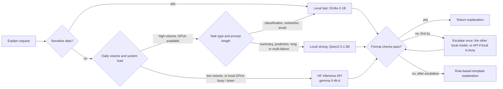

# DataPact Multi-Model System Design (A7)

INFO 490, Team 15. Benchmark (Part 1, Steps 1.1-1.5): Hriday Agarwal. Cost tables (Part 2,
Steps 2.1-2.4): Connor Slattery. Analysis (Steps 1.6 and 2.5) and assembly: Tejas Jaggi. Part 3
(routing design, section 4): Ashok Chacko.

Section 4 replaces the placeholder drafted during assembly. The scenario set and the
task-type routing idea are kept from that draft; the model pair, the classification route and
the evaluation have been re-derived from `results/benchmark_results.csv` and cross-checked
against the A6 benchmark. Changes are listed at the end of section 4.

This document covers the architecture reasoning, cost analysis and routing design. The numbers
come from `multi_model_system.ipynb`, which has the 375 benchmark runs, the 90-row cost tables and
the routing check. A7 is independent of the Django app. This is a design, and nothing in the app
was changed.

## 1. What the AI does in DataPact

DataPact checks recurring data files against versioned data contracts. Its AI feature explains
data-quality results. The benchmark tested the five tasks that feature has to handle:

| Task type | Example input | Expected output |
|---|---|---|
| Classification | a failed rule and sample values | JSON: `DATA_ISSUE` or `CONTRACT_UPDATED`, plus a reason |
| Structured extraction | a plain-English rule request ("humidity must be 0-100, just warn") | JSON: dataset, column, rule type, severity |
| Prediction | the last six pass rates for a dataset | JSON: trend and next-run PASS/FAIL |
| Summarization | a validation-run report | 1-2 sentence plain summary |
| Text generation | a failed check | short email to the data owner |

Requests are short: 90-218 prompt tokens in the benchmark, and 656 tokens in total (602 in,
54 out) for the app's real few-shot prompt measured in A6.

## 2. Architectural reasoning

### Which local models

We benchmarked 15 open models from 0.13B to 1.84B (5 size categories x 3 models) on 25 DataPact
prompts, using one Colab T4 and one request at a time.

| Model | Category | Avg score (1-10) | Latency (s) | Tokens/s | Peak GPU memory |
|---|---|---|---|---|---|
| **OLMo-2-0425-1B-Instruct** | Small | 8.55 | **0.86** | 41.9 | 3.0 GB |
| **Qwen2.5-1.5B-Instruct** | Medium | **8.93** | 1.78 | 25.5 | 3.1 GB |
| SmolLM2-1.7B-Instruct (current app model, A6) | Large | 8.22 | 1.60 | 36.9 | 3.5 GB |

The design is built on four findings from Step 1.6:

1. **Use two local models, not one.** OLMo-2-1B and Qwen2.5-1.5B are the only two models where no
   other model is both faster and better. OLMo is twice as fast, and Qwen is 0.38 points better on
   the same prompts. A fast default plus a stronger second model covers both needs, and together
   they need only about 6 GB of the T4's 16 GB.
2. **A bigger model is not automatically better.** The Large category (7.67) scored below Medium
   (8.21), and a 0.5B Qwen2.5 beat a 1.8B Qwen1.5. The router chooses models by measured results,
   not size.
3. **A smaller model is not faster.** On a T4 serving one request at a time, speed was 23-44
   tokens/s regardless of size. Routing to a tiny model saves memory, not latency, so the design
   has no "tiny model for speed" tier.
4. **Format checks predict quality.** The rubric's checks that need no answer key (valid JSON
   keys and allowed values, length limits, no looping, no cut-off) can run on every answer at
   serving time. Answers that pass them average 8.47, and answers that fail average 4.88.

### Components

- **Router.** It decides using five signals: data sensitivity, daily request volume, current
  GPU load (queue depth), task type and prompt length.
- **Local tier.** OLMo-2-1B (fast default) and Qwen2.5-1.5B (stronger), both on the same T4
  machines (AWS g4dn.4xlarge in the cost model), with batching once traffic justifies it.
- **API tier.** Hugging Face Inference Providers (gemma-3-4b-it through DeepInfra, the cheapest
  paid chat model we found). It serves as the main tier at low volume and as overflow and failover
  at high volume.
- **Validator.** The format checks from the Step 1.4 rubric. A failed answer is retried once on a
  different route: an OLMo answer goes to Qwen2.5-1.5B, a Qwen answer to OLMo-2-1B, and either one
  to the API if the local tier is busy.
- **Template fallback.** DataPact already knows the rule, column, row count and sample values, so
  it can always produce a plain explanation from a template. A validation result is never blocked
  on the AI.

## 3. Cost analysis

All figures are **estimates** from the Part 2 model. It assumes on-demand AWS prices, one
656-token request per user per day, machines planned at 70% busy, and Step 1.5 speeds measured
one request at a time. Connor's tables were re-run with the Step 1.5 speeds, and all 180 rows were
checked by recomputing them from the formulas.

| Daily users | Token load / day | Cheapest local ($/day) | API total ($/day) | Local, 32 at once* ($/day) |
|---|---|---|---|---|
| 1,000 | 656K | 28.90 | 2.03 | 28.90 |
| 10,000 | 6.56M | 28.90 | 2.35 | 28.90 |
| 100,000 | 65.6M | 86.69 | 5.55 | 28.90 |
| 1,000,000 | 656M | 606.82 | 39.49 | **28.90** |
| 10,000,000 | 6.56B | 5,808.10 | 388.95 | **231.17** |
| 100,000,000 | 65.6B | 58,052.06 | 3,881.47 | **2,196.10** |

\*What-if for SmolLM2-1.7B, assuming a GPU serves 32 requests at once without slowing each
request. This has not been measured.

- **One request at a time, the API is cheaper at every scale**, by 12-16x. One T4 costs $28.90 a
  day but serves only about 41,000-50,000 requests a day with the faster models, so each request
  costs about $0.0006. The API costs about $0.00004 per request, including app servers.
- **Local becomes cheaper only with batching and volume.** A T4 has to serve about 15-26
  requests at once to match the API, depending on the model. There also has to be enough
  traffic to fill it. One machine costs $28.90 a day, and the API reaches that cost at about 0.70M
  requests a day (web app servers counted on the API side only, as in the tables) or about 0.81M
  (counted on both sides). Below that, a GPU cannot win. In the 32-at-once what-if, local wins from
  1M daily users up: $28.90 vs $39.49 a day, or $32.89 vs $39.49 with the same two app servers
  added to local. At 10M users it saves about $158 a day (about $58K a year).
- **The decision:** start on the API, and move the main traffic to self-hosted GPUs once traffic
  stays above about 1M requests a day *and* a load test confirms about 20 or more requests at
  once per T4. Keep the API for overflow. A customer whose data cannot leave our servers needs
  local hosting at any scale.

**What could change this:** the API model's quality on our prompts was never measured, and it is
a 4B model, larger than ours. The API price ($0.05 / $0.10 per 1M input / output tokens, Connor's
figure) was rechecked on DeepInfra's own model page on Oct 26, 2026. Some third-party trackers
list $0.04 / $0.08, which we did not confirm and which would favor the API even more. Peak-hour headroom, operations
work and reserved or spot pricing are not modeled. More requests per user moves the crossover to
fewer users.

## 4. Routing design

Every figure in this section is computed from `results/benchmark_results.csv` (375 rows: 15
models x 25 prompts). Per-type averages are over the 5 prompts of that type, so differences
under about 0.4 points are inside the noise the rubric can resolve.

> **Open point for the team.** Section 2 recommends OLMo-2-1B + Qwen2.5-1.5B as the local pair,
> from the Step 1.6 analysis. The pair search below puts that pair 15th of 105 and recommends
> Qwen2.5-1.5B + SmolLM2-1.7B instead. Both readings come from the same 375 rows; they differ on
> how much latency is worth trading for accuracy. **Sections 2 and 4 should be reconciled before
> submission** so the document gives one answer. The reasoning for each is set out in its own
> section, and section 4 ends with a table of what changed and why.

### Step 3.1: Five system scenarios

| # | Scenario | Description (DataPact-specific) | Routing signals |
|---|---|---|---|
| 1 | **Normal operation** | Steady weekday traffic. Analysts click "explain" on failed checks one at a time and expect an answer in about a second. | task type, system load |
| 2 | **Peak usage hours** | Month-end and term-start uploads: many teams upload at once, each run produces several failures to explain, and requests spike far above the daily average. | queue depth, daily volume |
| 3 | **High-complexity requests** | Multi-failure run summaries, pass-rate trend predictions, contract rules written as free text, and prompts past the local few-shot budget. | task type, prompt length, format-check result |
| 4 | **Cost optimization at low volume** | Prototype to Growing Product, below the ~0.7M requests/day where a GPU starts to compete. A dedicated GPU would sit idle. | daily request volume |
| 5 | **System overload or outage** | A GPU node fails, the local queue passes the latency target, or the API errors or rate-limits. | system load, error rate, timeouts |

A cross-cutting rule applies in every scenario: **requests flagged as sensitive** (a customer
who does not permit third-party processing) **never go to the API.** They stay local and fall
back to the template. This is not a performance rule; it is the one routing condition that
cannot be traded against latency or cost.

### Step 3.2: Routing strategies

**The model pair.** With two models held in memory and each task type sent to whichever of the
two scored higher on it, every possible pair of the 15 models was evaluated:

| Pair | Blended score | Latency | Memory |
|---|---|---|---|
| Qwen2.5-1.5B + granite-3.1-1b | 9.09 | 1.81 s | 5.8 GB |
| **Qwen2.5-1.5B + SmolLM2-1.7B** | **9.08** | **1.66 s** | 6.6 GB |
| Qwen2.5-0.5B + Qwen2.5-1.5B | 9.01 | 1.68 s | 4.1 GB |
| OLMo-2-1B + Qwen2.5-1.5B | 8.93 | 1.71 s | 6.1 GB |

The last row is the pair used in the assembly draft; it ranks **15th of the 105 possible pairs**.
Qwen2.5-1.5B appears in every pair above it, so it is the fixed half of the pair; the question is
only what sits beside it.

**Qwen2.5-1.5B + SmolLM2-1.7B is the recommendation**, not the top-scoring pair, for two reasons.

The 0.01 separating it from the granite pair is far inside the noise floor, and **granite is not
stable across prompt formats.** On the A6 benchmark — the same classification task, a stricter
JSON schema — granite-3.1-1b scored **12% valid structure and 0% correct**, the worst Small model
tested. In A7 the same model is the best classifier at 9.20. A model whose score moves that far
when the prompt shape changes is a poor choice for DataPact's most frequent task, where the
prompt will keep changing as the contract fields evolve. SmolLM2-1.7B scored 100% valid in A6 and
9.80 on extraction and summarization in A7: it is consistent across both.

The third option, Qwen2.5-0.5B + Qwen2.5-1.5B at **4.1 GB**, is worth keeping on the table. It
gives up 0.07 points and 2.5 GB of GPU memory — which is the difference between needing a GPU
instance and not, and this project already knows that an idle GPU is the dominant cost at our
scale (section 3).

**Task-type assignment** for the recommended pair:

| Task type | Routed to | Score | Latency | Alternative |
|---|---|---|---|---|
| Classification | Qwen2.5-1.5B | 8.40 | 1.63 s | SmolLM2 6.80 |
| Structured extraction | SmolLM2-1.7B | 9.80 | 1.00 s | Qwen 9.60 |
| Summarization | SmolLM2-1.7B | 9.80 | 1.55 s | Qwen 9.24 |
| Prediction | Qwen2.5-1.5B | 7.60 | 0.99 s | SmolLM2 7.20 |
| Text generation | Qwen2.5-1.5B | 9.80 | 3.42 s | SmolLM2 7.50 |

Classification is the weakest cell in the table for both models (8.40 and 6.80) and it is
DataPact's primary feature. **No model in the benchmark exceeded 9.20 on it, and no model
exceeded 8.00 on prediction** — against 9.80 on extraction, summarization and text generation.
These two task types, not any model, are where the quality ceiling sits.

| Scenario | Routing strategy | Local models | API model | Expected benefit |
|---|---|---|---|---|
| 1. Normal operation | Route by task type as above. Every answer passes the format checks; a failure retries once on the other local model. | Qwen2.5-1.5B, SmolLM2-1.7B | none | 9.08 at 1.66 s, against 8.93 at 1.78 s for Qwen alone — better *and* faster |
| 2. Peak usage | Past a queue threshold (expected wait over 2 s), new requests overflow to the API rather than queue. Format-failure retries go to the API so they do not add to the local queue. Sensitive requests never overflow. | both, at capacity | gemma-3-4b-it | GPUs sized for normal load, not peak; overflow costs ~$0.00004/request |
| 3. High complexity | Summaries of multi-failure runs and trend predictions go to the stronger model for that type. Prompts over the local token budget go to the API. Trend predictions are cross-checked against a slope calculation on the pass rates, because no model reached 8.0 here. | Qwen2.5-1.5B | gemma-3-4b-it, long prompts | Quality spent where the benchmark shows the ceiling is lowest |
| 4. Cost optimization | Below ~0.7M requests/day send everything except sensitive requests to the API and run no GPU. Re-check weekly; move to local once volume holds above ~1M/day and the batching test passes. | OLMo-2-1B on shared hardware, sensitive only | gemma-3-4b-it | $2.03-$39.49/day against $28.90-$606.82 local (12-16x) |
| 5. Overload or outage | Fail over in steps: local, then API, then the rule-based template. If the API rate-limits, fall back to the single fastest local model (OLMo-2-1B, 0.86 s) and skip retries. Health checks back off progressively. | OLMo-2-1B | gemma-3-4b-it | The validation result is never blocked on the AI |

### Step 3.3: Evaluation of the strategy

Routes replayed over the measured Step 1.5 answers. **These are in-sample** — the rules were
chosen from the same 25 prompts, so the figures are an upper bound, not a prediction. The API
model was never benchmarked; every API figure is an assumption.

| Route (25 prompts) | Score | Latency | Sent to 2nd model |
|---|---|---|---|
| SmolLM2-1.7B only (current app model) | 8.22 | 1.60 s | 0% |
| OLMo-2-1B only | 8.55 | 0.86 s | 0% |
| Qwen2.5-1.5B only | 8.93 | 1.78 s | 0% |
| Draft's type rule (OLMo + Qwen) | 8.77 | 1.14 s | 40% |
| **Recommended type rule (Qwen + SmolLM2)** | **9.08** | **1.66 s** | 40% |
| Qwen2.5-1.5B, escalate on failed checks | 8.99 | 1.81 s | 4% |
| SmolLM2-1.7B, escalate on failed checks | 9.04 | 2.47 s | 32% |

**1. Latency.** Type routing decides *before* generating, so the common path is one model call.
Escalation designs pay a second call on every failure: SmolLM2 with escalation reaches a similar
9.04 but at 2.47 s, half a second slower than answering with Qwen alone and scoring less.

The recommended rule is 1.66 s against 1.78 s for Qwen alone — faster *and* 0.15 points better,
because extraction and summarization both go to the model that is simultaneously better and
quicker at them (SmolLM2: 9.80 at 1.00 s on extraction against Qwen's 9.60 at 1.63 s).

The draft's pair is genuinely faster still at 1.14 s. That speed comes from OLMo's 0.86 s, and it
costs 0.31 points. For an analyst who clicks "explain" and reads a sentence, 1.66 s and 1.14 s
are the same experience; 0.31 points of accuracy on a judgement they will act on is not. If the
latency budget later tightens — a batch backfill of 40 violations — the draft's pair is the
better choice, and section 5's validation protocol is how that would be decided.

**2. Cost.** Routing changes cost in three ways:

- **Fewer second calls.** Choosing before answering means 0% retries on the common path, against
  32% for the escalation design. Every avoided retry is GPU time or API tokens not spent.
- **Overflow instead of over-provisioning.** Sizing GPUs for the average and sending the peak to
  the API at ~$0.00004/request avoids paying for peak capacity 24 hours a day.
- **Both models on one machine.** 6.6 GB fits a single T4 with room to spare. The 4.1 GB
  Qwen-pair alternative would fit hardware a tier cheaper, for 0.07 points.

At our actual scale the cheapest option is no GPU at all (scenario 4). The local tier earns its
place above ~1M requests/day, or immediately for customers whose data cannot leave.

**3. Quality.** Three mechanisms, in order of how much they are relied on:

- **Measured assignment.** Each type goes to whichever model scored higher on that type. The
  blend keeps 9.08 of the 9.09 available from the best possible pair.
- **A format gate on every answer.** Across all 375 runs, answers passing the automated checks
  average **8.47** and failures average **4.88**. That gap is what makes a check that needs no
  answer key usable as a confidence signal at serving time.
- **A safe floor.** When every route fails, the rule-based template states the rule, column, row
  count and samples. The user sees less, never something invented.

The gate's limit is worth stating plainly: **format checks cannot catch wrong content.** A model
can emit flawless JSON with the wrong label — five models in A6 did exactly that, scoring 50% on
a balanced set by answering one label every time. That is why the router chooses by task type
before generating rather than relying on the gate to sort good from bad afterwards.

**Stability as a selection criterion.** Picking by average score alone would have chosen granite
on classification (9.20). The same model scored 0% correct on A6's classification prompts. Where
two models are within noise, the one that held up across both benchmarks is the safer route, and
nothing in a single benchmark would have revealed that.

**How to validate on new data.** The rule was chosen and scored on the same 25 prompts, so 9.08
is optimistic. To test it:

1. Freeze the rule: task-type map, format checks, one-retry limit, thresholds.
2. Build a fresh set of at least 10 prompts per type (50 total) from real DataPact runs, or
   written by someone who has not seen the 25, with answer keys written before any model runs.
3. Run Qwen2.5-1.5B, SmolLM2-1.7B and the API model with identical generation settings, scored by
   the Step 1.4 rubric code.
4. Compare routed against Qwen-only and SmolLM2-only: paired mean differences with standard
   errors, mean and 95th-percentile latency, cost per 1,000 requests.
5. Keep the type rule only if routed quality is within about two standard errors of the best
   single model while being faster or cheaper. Otherwise route everything to Qwen2.5-1.5B.

That run also produces the first measured numbers for the API tier, which is the largest
unmeasured assumption in this design.

### What changed from the assembly draft

| | Draft | This section | Why |
|---|---|---|---|
| Model pair | OLMo-2-1B + Qwen2.5-1.5B | Qwen2.5-1.5B + SmolLM2-1.7B | The draft's pair ranks 15th of 105; the new pair scores 9.08 against 8.77 and is still faster than Qwen alone |
| Classification route | OLMo-2-1B (8.40) | Qwen2.5-1.5B (8.40) | Equal on score; Qwen is the model that stays loaded for three other types |
| granite-3.1-1b | not considered | considered and rejected | Best classifier in A7 (9.20), worst in A6 (0% correct) — too format-fragile for the primary task |
| Evaluation | latency-first | states the trade explicitly | 1.14 s against 1.66 s is invisible to a user; 0.31 points on a judgement is not |

Scenario definitions, the sensitive-data rule, the overflow and failover designs, and the
validation protocol are kept from the draft.
## 5. Assumptions and limits

- The benchmark has 25 prompts (5 per type) scored by an automated rubric, so model differences
  under about 0.4 points are within noise. The routing results are in-sample.
- Speeds come from one run on one Colab T4, one request at a time. Batching gains are a what-if,
  not a measurement.
- Costs are estimates: on-demand prices checked Oct 23-26, 2026, one request per user per day,
  70% planned use, and no operations, monitoring or reserved/spot pricing.
- All 15 models are under 2B parameters (A6 constraint), so "Large" means 1.7-1.8B.
- The API model (gemma-3-4b-it) is a stand-in for "a comparable paid model". None of our 15
  models is sold as a paid API.
