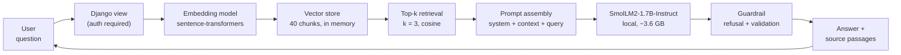

# A8 Part 4 — System Design Reflection

**Team 15, DataPact.** Author: Ashok Chacko (achac).

Written to be merged into `rag_analysis.md` as its Part 4 section. Where a figure depends on
Connor's experiment run it is marked **[from run]**; everything else is either arithmetic or a
measurement carried over from A6/A7 and labelled as such.

---

## Step 4.1 — Cost awareness

Three knobs drive the cost of this system, and they do not cost the same thing. Two of them are
paid once per corpus; the third is paid on **every single query**, which is why it dominates.

### What each knob actually costs

| Knob | Paid when | Scales with | What it touches |
|---|---|---|---|
| Embedding dimension | once per corpus, then once per query | vector width | index storage, search time, embed latency |
| Chunk size | once per corpus | number of chunks | index size, retrieval precision |
| Top-k | **every query** | tokens into the LLM | generation latency and token spend |

### Embedding dimension

Our three models span 384, 768 and 1024+ dimensions. Storage scales linearly: at 4 bytes per
float, our 40-paragraph corpus is roughly 40 × 384 × 4 ≈ **61 KB** at the small model and
**164 KB** at 1024 dimensions. At this size the difference is irrelevant — the whole index fits
in a browser tab.

That stays true for longer than people expect. A corpus of 100,000 chunks is ~154 MB at 384
dimensions and ~410 MB at 1024. Both fit in RAM on a modest server, so **dimension is almost
never the binding cost for a document-sized corpus.** It starts to matter at tens of millions of
chunks, or when an exhaustive scan becomes too slow and an approximate index is needed.

The real cost of a bigger embedding model is **latency per query**, not storage: every query is
embedded before anything can be searched, and that happens on the request path. **[from run]**

### Chunk size

Chunk size sets how many vectors exist. Halving chunk size roughly doubles the chunk count, the
index size and the embedding cost. But its more important effect is on *quality*, not price:

- **Chunks too small** fragment a thought, so the retrieved passage answers half the question and
  the model fills in the rest.
- **Chunks too large** bundle several topics, so a chunk matches on an irrelevant sentence and
  spends the context budget on text the user did not ask about.

Our fixed strategy uses 120 words, overlap pairs adjacent paragraphs, and hybrid splits only
above 150 words with a 60-word floor. Because our paragraphs are 91–115 words, each is already
close to one complete thought — which is why the corpus was written that way.

### Top-k — the one that compounds

Top-k is the only knob charged per request. With `TOP_K = 3` and ~100-word chunks, retrieved
context is roughly **400 tokens** per query, on top of the system prompt and the question.

Moving to k=5 adds ~270 tokens to *every* request. On the A6/A7 measurements for
SmolLM2-1.7B — ~602 prompt tokens and ~54 new tokens at 1.53 s per answer — a 45% larger prompt
is a direct increase in both latency and spend, paid on every query forever.

And it frequently makes answers *worse*. Chunks ranked 4th and 5th are, by definition, the ones
the retriever was least confident about. Adding them dilutes the signal and gives the model more
opportunity to answer from the wrong passage. **Top-k is where cost and quality are most likely
to move in the same direction, and the cheapest setting is often the best one.**

**Ranked by cost impact: top-k first, chunk size second, embedding dimension a distant third.**

---

## Step 4.2 — RAG vs alternatives

| Approach | Use it when | Avoid it when | Cost shape |
|---|---|---|---|
| **RAG** | Facts change; answers must cite a source; the corpus is bigger than the context window | The model's context window cannot hold the retrieved evidence | Per-query retrieval + larger prompts |
| **Fine-tuning** | You need a *format*, tone or behaviour, not facts; the task is stable | Information changes often; you need provenance | High one-off training, cheap per query |
| **Pure prompting** | The knowledge already sits in the model, or fits in the prompt | The corpus exceeds the context window; answers must be grounded | Cheapest; no infrastructure |

**Why RAG for DataPact's handbook.** Our documentation changes whenever a rule type or a workflow
changes. Fine-tuning would require retraining on every edit, and it cannot tell the user *which*
document an answer came from — which matters when somebody is deciding whether a violation is a
data issue. RAG updates by editing a Markdown file.

**We have direct evidence for the failure mode.** In A7 we applied retrieval to our 32-character
character-level SLM. The retriever found the correct document in **18 of 20 runs**, but it was
fully inside the context window in **0 of 20** — so every answer scored 1/10. Retrieval was
working perfectly and the system still failed, because the generator could not see the evidence.

In the same experiment, **fine-tuning the same checkpoint reached 5/5**, because facts written
into the weights are not subject to the context limit.

That is the sharpest lesson available to us: **RAG and fine-tuning fail along different axes.**
RAG is bounded by what the generator can read; fine-tuning is bounded by how often the facts
change. For A8 we use a model with a real context window, which is what makes RAG viable here
and was not true in A7.

**The pragmatic combination:** fine-tune once for output *shape*, use RAG for the *facts*.

---

## Step 4.3 — System design at 10,000 users/day

### Current architecture



```
User → Query → Embedding → Vector Store → Top-k → Prompt → LLM → Guardrail → Response
                                                                      ↓ fails
                                                           "not in the documents"
```

### Sizing the load

```
10,000 users/day × 2 questions      =  20,000 queries/day
Peak ≈ 4× average over an 8h day    ≈  2.8 queries/second at peak
Generation at ~1.5 s/query          ≈  4.2 concurrent generations at peak
```

So the system needs roughly **4–5 concurrent generation slots**, not hundreds. The embedding and
search steps are negligible beside generation: searching 40 vectors is microseconds, and even
100,000 vectors is a few milliseconds of brute-force cosine.

**Generation is >95% of the latency and essentially all of the cost.** Every optimisation below
targets that.

### What I would optimise, in order

**1. Cache aggressively.** Handbook questions repeat heavily — "how do I register a dataset" will
be asked thousands of times. An exact-match cache on the normalised query is trivial and, on a
documentation corpus, plausibly removes a large share of generation calls. This is the single
highest-leverage change and it is roughly twenty lines of code.

**2. Precompute the index.** Chunk and embed at deploy time, not per request. Nothing about a
static corpus needs embedding on the request path.

**3. Batch and queue generation.** With 4–5 concurrent slots, a small queue with a timeout
smooths peaks far more cheaply than provisioning for the worst second of the day.

**4. Keep top-k at 3.** Per §4.1, this is the per-query knob. Raising it costs on every request
and is not reliably better.

**5. Only then consider a vector database.** At 40 chunks — or 100,000 — a NumPy dot product is
faster than a network call to a vector service. Adding one before the corpus justifies it buys
operational complexity and no speed.

### What I would *not* do

Swap the small embedding model for the large one by default. Embedding cost sits on the request
path, and A7 taught us that bigger is not reliably better: the largest model we benchmarked was
the *worst* in its category, because a formatting habit broke its output. The embedding choice
should follow Connor's measured retrieval accuracy **[from run]**, not parameter count.

### Honest limits

- **The local model cannot run on our free hosting tier.** SmolLM2-1.7B needs ~3.6 GB of GPU
  memory or ~7 GB of RAM; PythonAnywhere's free tier gives 512 MB total, which `torch` alone
  exceeds. A 10,000-user deployment needs real hardware or a hosted inference API.
- From A7's arithmetic, an always-on GPU only beats per-token API pricing once it is genuinely
  busy — around 60,000 generations/day. At 20,000/day a hosted API is likely cheaper, and the
  cache in step 1 pushes that crossover further out.
- Scaling numbers above are projections from measured single-query latency, not load-test
  results. We have not run this under concurrency.
