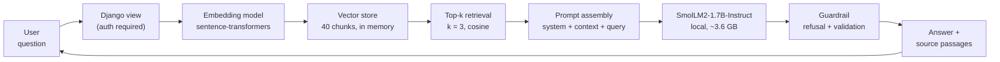

# A8 RAG Analysis: DataPact Handbook Q&A

**INFO 490 MG, Team 15.**

| Part | Owner | Where |
| --- | --- | --- |
| Part 1: RAG pipeline; Part 2: experiment runs; Step 3.3: improvement runs | Connor Slattery | `rag_system.ipynb`, `results/` |
| Knowledge base and test queries; Part 4: system design | Ashok Chacko | `knowledge_base/`, `test_queries.json`, Part 4 below |
| Evaluation metrics, manual grading, comparison tables, embedding and chunking analysis, failure analysis; this document | Hriday Agarwal | `evaluation/`, Parts 2-3 below |

Every number below comes from Connor's full run (AMD Radeon RX 7900 XTX, 8 Nov 2026) and from
`evaluation/rag_evaluation.ipynb`, which rebuilds the tables from `results/` and the hand grades in
`evaluation/manual_grades*.csv`. Nothing is estimated except where Part 4 says so.

**In one paragraph.** Retrieval works: the best setup (medium embeddings) put the answering text in
front of the model for 94% of answerable questions, and every setup refused both out-of-scope
questions. The weak link is the 1.7B generator. Of the 35 answers graded Poor, 24 had the right
text in their context, and 13 of those were refusals of questions the documents answer. A
stricter prompt removed every wrong refusal on the best setup and raised the manual answer score
from 45.8% to 62.5%. Bigger embeddings did not help, and fixed-length chunking, which looks
perfect on the automatic hit rate, splits sections in a way that hides the answer.


## Where each graded item is

| Rubric item | Where |
| --- | --- |
| 1.1 Knowledge base; 1.2 chunking (paragraph definition, overlap); 1.3 embeddings; 1.4 retrieval; 1.5 generation | `rag_system.ipynb` Part 1 (code and explanations); summary in Part 1 below |
| 2.1 Test queries | `test_queries.json`; Step 2.1 below |
| 2.2 Evaluation table with retrieved chunks, context quality, answer quality, latency and notes | Appendix A (all 9 configurations); metrics and summary in Step 2.2; full chunk text and answers in `evaluation/evaluation_table_graded.csv` |
| 2.3 Embedding comparison; 2.4 chunking comparison | Steps 2.3 and 2.4 |
| 2.5 Data scaling (subset vs full dataset) | Step 2.5 |
| 3.1 Failure cases; 3.2 root cause (chunking, embedding, query); 3.3 improvement before/after | Part 3 |
| 4.1 Cost; 4.2 RAG vs alternatives; 4.3 design for 10K users/day with diagram | Part 4 |

---

## Part 1: The pipeline (summary)

Full code and explanations are in `rag_system.ipynb`.

| Step | What we built |
| --- | --- |
| 1.1 Knowledge base | A DataPact user handbook: 9 Markdown documents, 40 sections, 4,019 words, every section 91-115 words (`knowledge_base/`) |
| 1.2 Chunking | **Fixed**: whole sentences up to about 120 words, ignoring section breaks (40 chunks). **Overlap**: paragraph pairs 1+2, 2+3, ... within a document (31 chunks, about 200 words). **Hybrid**: one chunk per section, joining sections under 60 words and splitting over 150, with the title and section name added before embedding (40 chunks) |
| 1.3 Embeddings | Small `all-MiniLM-L6-v2` (384 dimensions), medium `all-mpnet-base-v2` (768), large `BAAI/bge-large-en-v1.5` (1024), normalised so a dot product is cosine similarity |
| 1.4 Retrieval | Brute-force cosine search over a NumPy matrix, top 3 |
| 1.5 Generation | `SmolLM2-1.7B-Instruct` (our A6 choice), greedy decoding, 160 new tokens, a prompt with a system instruction, numbered context chunks and the question |

The prompt used for the 9-setup comparison:

> You answer questions about DataPact, a data quality tool. Use only the context below. If the
> context does not contain the answer, say: I could not find that in the documents.

---

## Part 2: Experiments

### Step 2.1: Test queries

14 queries in `test_queries.json`, each with the document, section and phrases a correct answer
needs. They get harder on purpose: easy ones share words with one section, hard ones compete with
two or three similar sections.

| Difficulty | Queries | Example |
| --- | --- | --- |
| Easy | q01-q03 | "What are the three statuses a contract version can have?" |
| Medium | q04-q07 | "Why won't the system let me delete a teammate's account?" (no shared words with the answer) |
| Hard | q08-q12 | "One new code appeared in thousands of rows. Is the data wrong or is our rule out of date?" |
| Out of scope | q13-q14 | "How much does a DataPact enterprise licence cost per seat?" (the right answer is a refusal) |

The difficulty labels held up: averaged over all 9 setups, the manual answer score was **72.2%**
on easy, **51.4%** on medium and **33.3%** on hard questions.

### Step 2.2: Evaluation table and metrics

Each of the 9 setups answered all 14 queries, giving 126 rows. **The complete evaluation table is
Appendix A**: one table per configuration with the query, the retrieved chunks (rank, source section
and similarity score), retrieved context quality, answer quality, latency and notes. The full text
of every retrieved chunk and every answer is in `evaluation/evaluation_table_graded.csv`.

**How we graded.** The run produced automatic scores (phrase matching), and left three columns
blank for people to fill in after reading the answers: `context_quality_manual`,
`answer_quality_manual` and `notes`. We read every row against the expected section and filled
them in:

| | Good | Partial | Poor |
| --- | --- | --- | --- |
| **Context** | The top 3 chunks contain the sentences needed to answer | They contain only some of them | The needed text was not retrieved |
| **Answer** | Correct and faithful to the documents | Core is right, but incomplete, padded with off-topic text, or has a misstatement | Wrong, invented, or refuses a question the documents answer |

Out-of-scope queries get N/A for context, and their answer is Good only if the model refused.

**Metrics.**

| Metric | Definition |
| --- | --- |
| Hit@3 (auto) | Share of answerable queries where a top-3 chunk touches the expected section |
| MRR@3 | Mean of 1 / rank of the first hit (0 if missed) |
| Context Good | Share of answerable queries whose top 3 contain the answering sentences (manual) |
| Answer score | Good = 1, Partial = 0.5, Poor = 0, averaged, as a % (manual) |
| Answer Good | Share of answerable queries answered fully right (manual) |
| Wrong refusals | Answerable queries the model refused |
| Correct refusals | Out-of-scope queries the model refused |
| Latency | Mean search time (ms) and generation time (s) from the run |

**Answer grade for every query and setup** (G Good, P Partial, X Poor):

| Query | Difficulty | small fixed | small hybrid | small overlap | medium fixed | medium hybrid | medium overlap | large fixed | large hybrid | large overlap |
| --- | --- | --- | --- | --- | --- | --- | --- | --- | --- | --- |
| q01 | easy | G | G | G | G | G | G | G | G | G |
| q02 | easy | P | P | P | P | P | P | P | P | P |
| q03 | easy | X | G | G | X | G | G | X | G | G |
| q04 | medium | P | G | X | P | P | P | P | P | X |
| q05 | medium | P | G | P | G | P | G | G | G | G |
| q06 | medium | G | X | P | G | X | P | G | G | P |
| q07 | medium | X | X | P | X | X | P | X | X | P |
| q08 | hard | X | P | X | X | X | X | X | X | X |
| q09 | hard | P | P | X | P | P | X | P | X | P |
| q10 | hard | G | X | P | P | P | P | P | G | P |
| q11 | hard | P | G | G | P | G | G | P | X | G |
| q12 | hard | X | X | X | X | X | X | X | X | X |
| q13 | out of scope | G | G | G | G | G | G | G | G | G |
| q14 | out of scope | G | G | G | G | G | G | G | G | G |

**All 9 setups** (12 answerable queries each; correct refusals out of 2):

| Embedding | Chunking | Hit@3 | MRR@3 | Context Good | Answer score | Answer Good | Wrong refusals | Correct refusals | Search ms | Generate s |
| --- | --- | --- | --- | --- | --- | --- | --- | --- | --- | --- |
| small | fixed | 100% | 0.903 | 83.3% | 45.8% | 25.0% | 3 | 2 | 4.9 | 0.82 |
| small | hybrid | 100% | 0.917 | **100%** | 54.2% | **41.7%** | 3 | 2 | 5.5 | 1.27 |
| small | overlap | 83.3% | 0.792 | 83.3% | 45.8% | 25.0% | 2 | 2 | 5.0 | 1.53 |
| medium | fixed | 100% | 0.875 | 91.7% | 45.8% | 25.0% | 3 | 2 | 9.8 | 1.06 |
| medium | hybrid | 100% | 0.861 | **100%** | 45.8% | 25.0% | 3 | 2 | 8.0 | 0.90 |
| medium | overlap | 91.7% | 0.875 | 91.7% | **54.2%** | 33.3% | 2 | 2 | 9.4 | 1.63 |
| large | fixed | 100% | 0.903 | 83.3% | 45.8% | 25.0% | 3 | 2 | 16.0 | 0.85 |
| large | hybrid | 83.3% | 0.750 | 83.3% | 50.0% | **41.7%** | 3 | 2 | 15.8 | 1.01 |
| large | overlap | 83.3% | 0.833 | 83.3% | **54.2%** | 33.3% | 2 | 2 | 16.2 | 1.34 |

The answer scores sit in a narrow band (45.8% to 54.2%). The setups differ more in what they
retrieve than in what the model writes from it, which Part 3 explains.

**How far the automatic scores can be trusted.** Auto and manual answer grades agree on only
**63%** of the 108 answerable rows. The phrase match is too strict on short correct answers (12
rows it called Partial were fully right, such as q06 small/fixed) and too lenient when an answer
quotes the right words but draws the wrong conclusion: it rated q09 small/overlap and medium/overlap
**Good** although both recommend CSV, the wrong format. The automatic hit rate has a blind spot
too, covered in Step 2.4. Anyone reading `results/summary_by_*.csv` on its own should treat the
auto columns as a first pass.

### Step 2.3: Embedding models

Averaged over the three chunking strategies:

| Embedding | Dimensions | Hit@3 | MRR@3 | Context Good | Answer score | Answer Good | Search ms | Index build s | Index size |
| --- | --- | --- | --- | --- | --- | --- | --- | --- | --- |
| small (MiniLM) | 384 | 94.4% | 0.870 | 88.9% | 48.6% | 30.6% | 5.1 | 0.06-0.07 | 0.05-0.06 MB |
| medium (mpnet) | 768 | **97.2%** | **0.870** | **94.4%** | 48.6% | 27.8% | 9.1 | 0.26-0.38 | 0.10-0.12 MB |
| large (bge) | 1024 | 88.9% | 0.829 | 83.3% | 50.0% | 33.3% | 16.0 | 0.94-1.46 | 0.13-0.16 MB |

**How does embedding size affect retrieval quality?** Medium retrieved best: the answering text was
in its top 3 for 94.4% of answerable questions, against 88.9% for small and 83.3% for large. All of
large's misses came from questions where two or three sections cover the same idea (q04, q08, q09):
it ranked the neighbouring section higher.

**How does embedding size affect answer quality?** Hardly at all. The manual answer score was 48.6%
for small and medium and 50.0% for large, a difference of about one Partial answer. The same
generator writes every answer, and Part 3 shows that most poor answers come from it, not from the
chunks, so better retrieval only goes so far.

**Did larger embeddings always perform better?** No. Large was the least accurate retriever, and it
cost the most: about 3x the search time of small (16.0 ms against 5.1 ms per query), 15-20x the
index build time and 2.7x the storage. Our documents are short and written in plain language, and
the questions are everyday wording, so the general-purpose mid-size model was the best fit.

### Step 2.4: Chunking strategies

Averaged over the three embedding models:

| Chunking | Chunks | Avg words | Hit@3 | MRR@3 | Context Good | Answer score | Answer Good | Wrong refusals | Generate s |
| --- | --- | --- | --- | --- | --- | --- | --- | --- | --- |
| fixed | 40 | ~100 | **100%** | **0.894** | 86.1% | 45.8% | 25.0% | 9 | **0.91** |
| hybrid | 40 | ~100 | 94.4% | 0.843 | **94.4%** | 50.0% | **36.1%** | 9 | 1.06 |
| overlap | 31 | ~200 | 86.1% | 0.833 | 86.1% | **51.4%** | 30.6% | **6** | 1.50 |

**Which chunking strategy worked better, and why?** It depends on which number you trust, and that
is the main finding of this section.

* By the automatic **hit rate, fixed looks perfect** (100%). But a hit only means a chunk *touched*
  the expected section. Fixed chunks cut every 120 words regardless of headings, so a section can
  be split across two chunks with only one of them retrieved. That happened 5 times. In q03 ("What
  are the three statuses...?") the fixed chunk ends at *"A contract version has one of three
  statuses."*, and the statuses themselves are in the next chunk, which was not retrieved. The
  run counted these as hits; the model answered "three statuses: one of three statuses" (small),
  "active, history, and draft" (medium) and "unique per dataset, version three" (large). q12 had
  the same problem.
* By whether the **answering text actually reached the model, hybrid is best** (94.4%, and 100% with
  the small and medium models). It keeps each section whole and adds the section name to what is
  embedded, so a chunk is always one complete topic.
* By **answer quality, overlap is slightly ahead** (51.4%). Its chunks are two sections long, so when
  it does retrieve the right place the model gets more surrounding text, and it had the fewest
  wrong refusals (6). The cost is retrieval precision: a chunk that is half about one section and
  half about another is easier for a near-miss section to outrank, so overlap missed q04 with every
  model and q08 with two.

**How did chunking affect retrieval relevance and the final answers?** Chunk boundaries decide what
the model sees. Fixed chunks are the most precise to retrieve but can cut an answer in half;
overlap chunks keep context together but blur topics; hybrid chunks follow the document's own
structure and gave the model the complete answer most often. Two-topic chunks also cause a
generation problem: in q09 the overlap chunk holds both the CSV and the JSON sections, and the
model recommended CSV with small and medium embeddings even though the same chunk says JSON
"suits anything that will be read by a program". Longer chunks also cost time: overlap answers took
1.50 s on average against 0.91 s for fixed, because the prompt is about twice as long.

### Similarity threshold (from the run)

A threshold would let the app refuse before calling the model when the best chunk is not similar
enough. It does not work here: in 6 of 9 setups the best out-of-scope question scored higher than
the worst answerable one (for medium + fixed, 0.417 against 0.356), and the three setups with a gap
had less than 0.01 of margin. We rely on the prompt instead, which refused q13 and q14 in all 9
setups.

### Step 2.5: Data scaling (best setup, medium + fixed)

The answer chunks stay in every test; 25%, 50% and 100% of the other chunks are added around them.

| Share of other chunks | Chunks | Hit@3 | Wrong-section share of top 3 | Mean margin (best right - best wrong) | Queries where a wrong chunk ranked first |
| --- | --- | --- | --- | --- | --- |
| 25% | ~11 | 100% | 50.0% | 0.223 | 0 |
| 50% | ~21 | 100% | 50.0% | 0.186 | 2 |
| 100% | 40 | 100% | 55.6% | 0.128 | 3 |

**How does dataset size affect retrieval quality and noise?** The right section stayed in the top 3
at every size, but it won by less and less: the average margin over the best wrong chunk fell from
0.223 to 0.128, and the number of questions where a wrong chunk outranked every right one went from
0 to 3 (q04 and q08 from 50%, then q12). Noise in the top 3 rose from 50.0% to 55.6%. At 40 chunks
this costs nothing yet because top 3 still catches the right chunk, but the trend says a larger
handbook would start pushing answers out of the top 3, which is when re-ranking or section-aware
chunking would be needed.

---

## Part 3: Failure analysis and improvement

### Step 3.1: Failure cases

We read every Poor answer. These five cover the failure types we saw; each comes with the
retrieved chunks and the exact answer.

**Failure 1: refusing a question the documents answer (q07, q12).**
q07 asked "Duplicate IDs showed up in a key column. How do I tell whether the file was exported
twice?" Every setup retrieved the `rule_types.md > Unique` section first, and it contains the exact
answer ("Comparing the number of failed rows against the total row count is the quickest way to
tell which happened"). With fixed and hybrid chunks all six setups answered **"I could not find that
in the documents."** q12 ("A single rule is failing on almost every row. Where should I look
first?") was refused by **all 9 setups**, although 7 of them had the full answering section. Across
the table, 15 answers to answerable questions were nothing but the refusal line, and 13 of those had
Good context. A related form showed up in q02: all 9 setups gave the right steps and then ended
with the refusal line anyway, along with invented button names ("Click on the 'Register' button")
that the handbook never mentions.

**Failure 2: a chunk boundary hides the answer (q03, fixed chunking).**
Described in Step 2.4. The fixed chunk stops one sentence before the list of statuses, so the model
had the question's words but not the answer. Medium + fixed wrote "active, history, and draft": it
took "history" from a nearby sentence ("earlier ones kept as history"). The run's hit metric scored
all three rows as hits, so this failure is invisible unless someone reads the chunks.

**Failure 3: the right passage, the wrong conclusion (q08).**
"One new code appeared in thousands of rows. Is the data wrong or is our rule out of date?" The
handbook's answer is a contract update, with three signals (how many rows failed, whether the new
values are all the same, whether they look plausible). 8 of 9 setups answered Poor. Five of them had
the decision-signals section in their top 3 and still got it wrong: three replied **"The data is
(probably) out of date."**, which answers neither half of the question, medium + hybrid said the
data "is almost certainly the thing that needs updating", and medium + overlap said "likely a data
issue" and then argued for a new category. Three neighbouring sections (Allowed values, Every row fails one
rule, Row counts) all discuss the same judgement in slightly different words, and the 1.7B model
could not weigh three signals against each other.

**Failure 4: choosing the wrong option from a two-topic chunk (q09, overlap).**
"If a program is going to read the download rather than a person, which format should I pick?"
The overlap chunk `CSV export + JSON export` contains the answer, yet small and medium overlap both
recommended **CSV**, then pasted the JSON paragraph underneath. The model latched onto the first
half of the chunk. The automatic grader scored both answers Good because the expected phrases
appear in the pasted text.

**Failure 5: invented procedure when retrieval misses (q04, overlap).**
"Can I change a contract after it has already been used to check a file?" With overlap chunks no
model retrieved the `Editing a contract that has been used` section. Large + overlap answered: "If
you need to make changes to a contract, you should move it from the active status to the retired
status first, and then update the contract with the new changes." The handbook says the opposite:
a used version "must never be edited", and changes go into a new version.

### Step 3.2: Root cause analysis

For each failure we asked the assignment's three questions: was it the chunking, the embedding
model, or the way the query was worded? Having 9 setups makes this testable. If a failure happens
with every embedding model, the embedding model is not the cause; if it disappears when only the
chunking changes, the chunking is.

| Failure | Chunking? | Embedding model? | Query formulation? | Main cause |
| --- | --- | --- | --- | --- |
| 1. Refusing answerable questions (q07, q12) | **Partly.** For q07 all 3 overlap setups answered while all 6 fixed and hybrid setups refused, so the longer two-section chunk helped the model commit. For q12, fixed chunks with the small and large models held only the section's first sentence | **No.** Every model ranked the answering section first for q07 and in the top 3 for q12; the refusals look the same with all three | **Yes, partly.** Both are diagnostic questions worded differently from the answer ("how do I tell whether it was exported twice" against "comparing the number of failed rows against the total row count"; "where should I look first" against "suspect the rule or the export… look at the sample values first") | **Generation and prompt.** The model fell back on the refusal line the prompt gave it. The strict prompt removed these refusals (Step 3.3) |
| 2. Chunk boundary hides the answer (q03, fixed) | **Yes, the main cause.** The 120-word cut lands one sentence before the list of statuses. Hybrid and overlap answered correctly with all three models | **No.** All three models retrieved the same truncated chunk first | **No.** An easy question with the same words as the section | **Chunking** |
| 3. Right passage, wrong conclusion (q08) | **Partly.** Overlap missed the section with the small and large models | **Partly.** Large missed it with hybrid and overlap, ranking "Every row fails one rule" and "Row counts" higher; medium never missed it | **Yes.** It describes a scenario ("one new code appeared in thousands of rows") that matches four sections about equally, and asks for a judgement rather than a fact | **Query formulation plus generation.** 5 setups had the decision signals in their context and still answered wrong |
| 4. Wrong option from a two-topic chunk (q09) | **Yes.** The overlap chunk holds the CSV and JSON sections together, and the model took the CSV half | **Partly.** Large + hybrid was the only setup that missed the JSON section entirely | **Partly.** "Download" matches the CSV text ("the download filename carries a timestamp"), and the question never says JSON or export | **Chunking** (and the generator reading only the first half) |
| 5. Invented procedure after a retrieval miss (q04, overlap) | **Yes.** No model found the section with overlap chunks; every model found it at rank 1 with hybrid chunks | **No.** The miss is the same with all three models | **Partly.** "Change a contract after it has been used" shares words with "What a contract is" and "Contract versions", which outranked the editing section | **Chunking**, then the generator inventing instead of refusing |

**Across all Poor answers** (35 of 108 answerable rows), the split between retrieval and generation:

| Cause | Refused an answerable question | Wrong or invented content | Total |
| --- | --- | --- | --- |
| **Generation**: the answer text was in the context | 13 | 11 | **24** |
| **Retrieval**: the answer text was not (fully) retrieved | 2 | 9 | **11** |
| Total | 15 | 20 | 35 |

So the embedding model was rarely the deciding factor: no failure above is explained by it alone,
which matches Step 2.3, where answer scores barely moved between models. Chunking explains most
retrieval failures, query wording explains why the hard questions were hard, and the 1.7B generator
explains the two thirds of failures that happened after retrieval had worked. It refuses when the
answer is phrased differently from the question (Failure 1), grabs the first plausible sentence
instead of the right one (Failures 3 and 4), and invents when the context is wrong (Failure 5).

### Step 3.3: Improvement attempt

The run tested three single changes on the best setup (medium + fixed). The baseline rows are
identical to medium + fixed in the main table (checked in the evaluation notebook). We graded the
new answers by hand with the same rubric:

| Variant | Hit@k (auto) | Answer score (manual) | Good / Partial / Poor | Wrong refusals | Out-of-scope refused | Generate s |
| --- | --- | --- | --- | --- | --- | --- |
| Baseline (top 3, normal prompt) | 100% | 45.8% | 3 / 5 / 4 | 3 | 2 of 2 | 0.86 |
| Top 1 | 75.0% | 41.7% | 3 / 4 / 5 | 4 | 2 of 2 | 0.65 |
| Top 5 | 100% | 58.3% | 4 / 6 / 2 | 3 | 2 of 2 | 0.82 |
| **Strict prompt (top 3)** | 100% | **62.5%** | **5 / 5 / 2** | **0** | 2 of 2 | **0.67** |

The strict prompt:

> You answer questions about DataPact, a data quality tool. Answer in one or two sentences, using
> only the numbered context. Do not add facts that are not in the context. If the context does not
> contain the answer, reply only with: I could not find that in the documents.

**Before and after (baseline vs strict prompt).** Four answers improved and none got worse:

| Query | Before | After | What changed |
| --- | --- | --- | --- |
| q02 | Partial | Good | No invented buttons and no refusal line; adds "unique for the owner" |
| q07 | Poor (refused) | Partial | Answers with the right method |
| q09 | Partial | Good | "The JSON export should be chosen", with no false claims about JSON |
| q12 | Poor (refused) | Partial | Answers from the right section (check for renamed columns) |

It still refused both out-of-scope questions, and answers got faster (0.86 s to 0.67 s) because
they are shorter.

**What it did not fix.** q03 is still "active, history, and draft" (the split chunk, Failure 2) and
q08 is still "The data is likely out of date." (Failure 3). Those are a chunking problem and a
reasoning limit, and no instruction changes either.

**Top-k.** Top 1 was worse: the right section was missed for 3 of 12 questions. Top 5 was better
than the baseline (58.3% against 45.8%), mostly because the extra chunks brought back the second
half of q03's split section, so it answered "active, retired, and draft" correctly. That is a
patch for the fixed-chunk problem rather than a reason to retrieve more in general; the cleaner fix
is to keep sections whole.

---

## Part 4: System design reflection

**Team 15, DataPact.** Author: Ashok Chacko (achac).

Figures that depended on Connor's experiment run were marked *[from run]* in the draft and have
been filled in from `results/`; everything else is either arithmetic or a measurement carried over
from A6/A7 and labelled as such.

---

### Step 4.1 — Cost awareness

Three knobs drive the cost of this system, and they do not cost the same thing. Two of them are
paid once per corpus; the third is paid on **every single query**, which is why it dominates.

#### What each knob actually costs

| Knob | Paid when | Scales with | What it touches |
|---|---|---|---|
| Embedding dimension | once per corpus, then once per query | vector width | index storage, search time, embed latency |
| Chunk size | once per corpus | number of chunks | index size, retrieval precision |
| Top-k | **every query** | tokens into the LLM | generation latency and token spend |

#### Embedding dimension

Our three models span 384, 768 and 1024+ dimensions. Storage scales linearly: at 4 bytes per
float, our 40-paragraph corpus is roughly 40 × 384 × 4 ≈ **61 KB** at the small model and
**164 KB** at 1024 dimensions. At this size the difference is irrelevant — the whole index fits
in a browser tab.

That stays true for longer than people expect. A corpus of 100,000 chunks is ~154 MB at 384
dimensions and ~410 MB at 1024. Both fit in RAM on a modest server, so **dimension is almost
never the binding cost for a document-sized corpus.** It starts to matter at tens of millions of
chunks, or when an exhaustive scan becomes too slow and an approximate index is needed.

The real cost of a bigger embedding model is **latency per query**, not storage: every query is
embedded before anything can be searched, and that happens on the request path. In our run,
embedding the query and searching took about **5 ms** with the small model, **9 ms** with medium and
**16 ms** with large (mean `search_ms`, `results/summary_by_model.csv`) *[from run]*.

#### Chunk size

Chunk size sets how many vectors exist. Halving chunk size roughly doubles the chunk count, the
index size and the embedding cost. But its more important effect is on *quality*, not price:

- **Chunks too small** fragment a thought, so the retrieved passage answers half the question and
  the model fills in the rest.
- **Chunks too large** bundle several topics, so a chunk matches on an irrelevant sentence and
  spends the context budget on text the user did not ask about.

Our fixed strategy uses 120 words, overlap pairs adjacent paragraphs, and hybrid splits only
above 150 words with a 60-word floor. Because our paragraphs are 91–115 words, each is already
close to one complete thought — which is why the corpus was written that way.

#### Top-k — the one that compounds

Top-k is the only knob charged per request. With `TOP_K = 3` and ~100-word chunks, retrieved
context is roughly **400 tokens** per query, on top of the system prompt and the question.

Moving to k=5 adds ~270 tokens to *every* request. On the A6/A7 measurements for
SmolLM2-1.7B — ~602 prompt tokens and ~54 new tokens at 1.53 s per answer — a 45% larger prompt
is a direct increase in both latency and spend, paid on every query forever.

And it frequently makes answers *worse*. Chunks ranked 4th and 5th are, by definition, the ones
the retriever was least confident about. Adding them dilutes the signal and gives the model more
opportunity to answer from the wrong passage. **Top-k is where cost and quality are most likely
to move in the same direction, and the cheapest setting is often the best one.**

**Ranked by cost impact: top-k first, chunk size second, embedding dimension a distant third.**

---

### Step 4.2 — RAG vs alternatives

| Approach | Use it when | Avoid it when | Cost shape |
|---|---|---|---|
| **RAG** | Facts change; answers must cite a source; the corpus is bigger than the context window | The model's context window cannot hold the retrieved evidence | Per-query retrieval + larger prompts |
| **Fine-tuning** | You need a *format*, tone or behaviour, not facts; the task is stable | Information changes often; you need provenance | High one-off training, cheap per query |
| **Pure prompting** | The knowledge already sits in the model, or fits in the prompt | The corpus exceeds the context window; answers must be grounded | Cheapest; no infrastructure |

**Why RAG for DataPact's handbook.** Our documentation changes whenever a rule type or a workflow
changes. Fine-tuning would require retraining on every edit, and it cannot tell the user *which*
document an answer came from — which matters when somebody is deciding whether a violation is a
data issue. RAG updates by editing a Markdown file.

**We have direct evidence for the failure mode.** In A7 we applied retrieval to our 32-character
character-level SLM. The retriever found the correct document in **18 of 20 runs**, but it was
fully inside the context window in **0 of 20** — so every answer scored 1/10. Retrieval was
working perfectly and the system still failed, because the generator could not see the evidence.

In the same experiment, **fine-tuning the same checkpoint reached 5/5**, because facts written
into the weights are not subject to the context limit.

That is the sharpest lesson available to us: **RAG and fine-tuning fail along different axes.**
RAG is bounded by what the generator can read; fine-tuning is bounded by how often the facts
change. For A8 we use a model with a real context window, which is what makes RAG viable here
and was not true in A7.

**The pragmatic combination:** fine-tune once for output *shape*, use RAG for the *facts*.

---

### Step 4.3 — System design at 10,000 users/day

#### Current architecture



```
User → Query → Embedding → Vector Store → Top-k → Prompt → LLM → Guardrail → Response
                                                                      ↓ fails
                                                           "not in the documents"
```

#### Sizing the load

```
10,000 users/day × 2 questions      =  20,000 queries/day
Peak ≈ 4× average over an 8h day    ≈  2.8 queries/second at peak
Generation at ~1.5 s/query          ≈  4.2 concurrent generations at peak
```

So the system needs roughly **4–5 concurrent generation slots**, not hundreds. The embedding and
search steps are negligible beside generation: searching 40 vectors is microseconds, and even
100,000 vectors is a few milliseconds of brute-force cosine.

**Generation is >95% of the latency and essentially all of the cost.** Every optimisation below
targets that.

#### What I would optimise, in order

**1. Cache aggressively.** Handbook questions repeat heavily — "how do I register a dataset" will
be asked thousands of times. An exact-match cache on the normalised query is trivial and, on a
documentation corpus, plausibly removes a large share of generation calls. This is the single
highest-leverage change and it is roughly twenty lines of code.

**2. Precompute the index.** Chunk and embed at deploy time, not per request. Nothing about a
static corpus needs embedding on the request path.

**3. Batch and queue generation.** With 4–5 concurrent slots, a small queue with a timeout
smooths peaks far more cheaply than provisioning for the worst second of the day.

**4. Keep top-k at 3.** Per §4.1, this is the per-query knob. Raising it costs on every request
and is not reliably better.

**5. Only then consider a vector database.** At 40 chunks — or 100,000 — a NumPy dot product is
faster than a network call to a vector service. Adding one before the corpus justifies it buys
operational complexity and no speed.

#### What I would *not* do

Swap the small embedding model for the large one by default. Embedding cost sits on the request
path, and A7 taught us that bigger is not reliably better: the largest model we benchmarked was
the *worst* in its category, because a formatting habit broke its output. The embedding choice
should follow Connor's measured retrieval accuracy (medium: 97% Hit@3, and the answering text
in the top 3 for 94% of questions, against 89% and 83% for large) *[from run]*, not parameter count.

#### Honest limits

- **The local model cannot run on our free hosting tier.** SmolLM2-1.7B needs ~3.6 GB of GPU
  memory or ~7 GB of RAM; PythonAnywhere's free tier gives 512 MB total, which `torch` alone
  exceeds. A 10,000-user deployment needs real hardware or a hosted inference API.
- From A7's arithmetic, an always-on GPU only beats per-token API pricing once it is genuinely
  busy — around 60,000 generations/day. At 20,000/day a hosted API is likely cheaper, and the
  cache in step 1 pushes that crossover further out.
- Scaling numbers above are projections from measured single-query latency, not load-test
  results. We have not run this under concurrency.


### Evaluation notes on Part 4 (Hriday)

Three statements in Part 4 were written before the run's results were graded. Where the
measurements say something different, the measurements in Parts 2 and 3 take precedence:

* **Top-k = 5.** Part 4 expects k = 5 to make answers worse. In our run it did not: on the best
  setup it kept the hit rate at 100% and raised the manual answer score from 45.8% to 58.3%, mainly
  by retrieving the second half of a section that fixed chunking had split (Step 3.3). The cost
  point stands, since every extra chunk lengthens every prompt, so k = 3 with section-aware chunking
  remains the recommendation.
* **GPU vs API break-even.** The figure of about 60,000 generations a day does not come from our A7
  cost tables. Those tables found the hosted API cheaper than a rented T4 machine at every traffic
  level when one request runs at a time; local hosting won only from about 1 million daily users,
  and only if each GPU serves 32 requests at once ($28.90 against $39.49 a day at 1 million). At 20,000 queries a day, both point the
  same way: a hosted API is cheaper.
* **"Bigger is not reliably better."** The example comes from A6, not A7, and the model whose
  formatting habit broke its output was H2O-Danube2-1.8B, the second-largest of the 15. The
  conclusion holds and is confirmed for embeddings in Step 2.3: the largest embedding model
  retrieved worst.

---

## Recommendation for the app (A9)

* **Medium embeddings** (`all-mpnet-base-v2`): best retrieval, at 9 ms per query.
* **The strict prompt**: the only change that removed wrong refusals, and it kept both refusals of
  out-of-scope questions.
* **Top 3**, and **no similarity threshold** (the scores overlap).
* **Chunking: test hybrid with the strict prompt before settling.** The run measured the strict
  prompt only with fixed chunks. Hybrid gave the model the complete answering text for 100% of
  questions with the medium model, against 91.7% for fixed, and it cannot split a section the way
  fixed did in q03. Until that test is run, fixed + strict prompt is the best measured setup.
* **Keep showing the source passages** next to every answer. Failures 3 to 5 are confident and
  wrong, and the passage is how a user catches that.

---

## Appendix A: Full evaluation table (Step 2.2)

Generated by `evaluation/rag_evaluation.ipynb` from the run's results and our manual grades. Each
retrieved chunk is shown as `rank. document > section (cosine similarity)`; a chunk that spans two
sections lists both. Latency is the total time per query (search plus generation), with the search
time in brackets. The full chunk text and every answer are in `evaluation/evaluation_table_graded.csv`.

#### small embeddings + fixed chunking

| Query | Retrieved chunks (rank. section (score)) | Context quality | Answer quality | Latency | Notes |
| --- | --- | --- | --- | --- | --- |
| q01: What does a not null rule check for? | 1. rule_types.md > Not null (0.702)<br>2. contracts.md > Writing a new rule + Editing a contract that has been used (0.506)<br>3. troubleshooting.md > Every row fails one rule + The run says error rather than failed (0.419) | Good | Good | 0.69 s (4 ms search) | Correct: empty strings, missing fields and true nulls. |
| q02: How do I register a new dataset in DataPact? | 1. getting_started.md > Registering a dataset (0.719)<br>2. accounts_and_access.md > Creating an account + Signing in with Google (0.532)<br>3. getting_started.md > Who owns a dataset + Your first upload (0.460) | Good | Partial | 1.55 s (5 ms search) | Right steps (Manage Datasets, name, team, description), but invents button labels and ends with 'I could not find that in the documents', contradicting itself. |
| q03: What are the three statuses a contract version can have? | 1. contracts.md > Contract versions + Activating and retiring a version (0.633)<br>2. contracts.md > What a contract is (0.460)<br>3. contracts.md > Writing a new rule + Editing a contract that has been used (0.444) | Poor | Poor | 0.28 s (5 ms search) | Says 'three statuses: one of three statuses'. Fixed chunk ends at 'has one of three statuses.'; the statuses are in the next chunk, which was not retrieved. |
| q04: Can I change a contract after it has already been used to check a file? | 1. contracts.md > Editing a contract that has been used (0.416)<br>2. contracts.md > What a contract is (0.398)<br>3. validation_runs.md > Starting a run (0.349) | Good | Partial | 0.90 s (5 ms search) | Correct 'no', but leaves out that changes are saved as a new version; padded with a definition of a contract. |
| q05: Why won't the system let me delete a teammate's account? | 1. getting_started.md > Who owns a dataset + Your first upload (0.478)<br>2. contracts.md > Editing a contract that has been used (0.285)<br>3. accounts_and_access.md > Creating an account + Signing in with Google (0.269) | Good | Partial | 2.13 s (5 ms search) | Correct, but adds an off-topic sentence about submitting files. |
| q06: What is the difference between a run that failed and a run that errored? | 1. validation_runs.md > Run outcomes + Row counts and partial files (0.662)<br>2. reports_and_exports.md > Grouped summaries + CSV export (0.489)<br>3. validation_runs.md > How a run is scored + Run outcomes (0.483) | Good | Good | 1.03 s (5 ms search) | Correct on both outcomes. |
| q07: Duplicate IDs showed up in a key column. How do I tell whether the file was exported twice? | 1. rule_types.md > Unique (0.673)<br>2. reports_and_exports.md > JSON export (0.423)<br>3. reports_and_exports.md > CSV export + JSON export (0.416) | Good | Poor | 0.19 s (5 ms search) | Wrong refusal: the Unique section with the answer was retrieved first. |
| q08: One new code appeared in thousands of rows. Is the data wrong or is our rule out of date? | 1. validation_runs.md > Row counts and partial files (0.603)<br>2. rule_types.md > Allowed values (0.520)<br>3. violations.md > Data issue or contract updated + Recurring violations (0.518) | Good | Poor | 0.18 s (5 ms search) | Does not answer the either/or: 'the data is out of date', with none of the signals. |
| q09: If a program is going to read the download rather than a person, which format should I pick? | 1. reports_and_exports.md > CSV export + JSON export (0.527)<br>2. reports_and_exports.md > JSON export (0.285)<br>3. violations.md > Sample values + Deciding the resolution (0.185) | Good | Partial | 1.40 s (5 ms search) | Picks JSON (correct), but credits JSON with CSV's 'no nested structure'. |
| q10: Can anyone see our data without signing in? | 1. accounts_and_access.md > Creating an account + Signing in with Google (0.452)<br>2. accounts_and_access.md > What anonymous visitors can see + Protected and public endpoints (0.423)<br>3. accounts_and_access.md > Protected and public endpoints (0.400) | Good | Good | 0.97 s (5 ms search) | Correct: sessions required; only the run-outcome summary is public, with no sensitive data. |
| q11: Why is there no AI explanation showing on this violation? | 1. ai_explanations.md > Why a suggestion may be missing + Limits of the suggestion (0.577)<br>2. troubleshooting.md > The run says error rather than failed + Explanations are unavailable (0.479)<br>3. ai_explanations.md > How a suggestion is produced + Why a suggestion may be missing (0.401) | Good | Partial | 0.43 s (5 ms search) | Correct but thin: 'failed validation twice', with no retry or fallback. |
| q12: A single rule is failing on almost every row of the file. Where should I look first? | 1. troubleshooting.md > A file will not upload + Every row fails one rule (0.646)<br>2. validation_runs.md > Row counts and partial files (0.640)<br>3. rule_types.md > Unique (0.586) | Partial | Poor | 0.19 s (5 ms search) | Wrong refusal. The fixed chunk has only the section's first sentence ('suspect the rule or the export'); the causes are in the next chunk. |
| q13: How much does a DataPact enterprise licence cost per seat? | 1. getting_started.md > Registering a dataset (0.361)<br>2. accounts_and_access.md > Creating an account + Signing in with Google (0.322)<br>3. ai_explanations.md > How a suggestion is produced + Why a suggestion may be missing (0.245) | nan | Good | 0.20 s (6 ms search) | Out of scope; correctly refused. |
| q14: What phone number do I call for DataPact support at the weekend? | 1. getting_started.md > Registering a dataset (0.457)<br>2. violations.md > Deciding the resolution + Data issue or contract updated (0.368)<br>3. accounts_and_access.md > Creating an account + Signing in with Google (0.363) | nan | Good | 0.20 s (5 ms search) | Out of scope; correctly refused. |

#### small embeddings + hybrid chunking

| Query | Retrieved chunks (rank. section (score)) | Context quality | Answer quality | Latency | Notes |
| --- | --- | --- | --- | --- | --- |
| q01: What does a not null rule check for? | 1. rule_types.md > Not null (0.673)<br>2. contracts.md > Writing a new rule (0.438)<br>3. rule_types.md > Allowed values (0.423) | Good | Good | 2.12 s (6 ms search) | Correct, but copies the whole chunk word for word. |
| q02: How do I register a new dataset in DataPact? | 1. getting_started.md > Registering a dataset (0.726)<br>2. getting_started.md > Who owns a dataset (0.460)<br>3. accounts_and_access.md > Creating an account (0.442) | Good | Partial | 1.62 s (6 ms search) | Right steps (Manage Datasets, name, team, description), but invents button labels and ends with 'I could not find that in the documents', contradicting itself. |
| q03: What are the three statuses a contract version can have? | 1. contracts.md > Contract versions (0.643)<br>2. contracts.md > Activating and retiring a version (0.601)<br>3. contracts.md > Editing a contract that has been used (0.519) | Good | Good | 0.35 s (5 ms search) | Correct: draft, active, retired. |
| q04: Can I change a contract after it has already been used to check a file? | 1. contracts.md > Editing a contract that has been used (0.472)<br>2. getting_started.md > Your first upload (0.401)<br>3. contracts.md > What a contract is (0.401) | Good | Good | 2.17 s (6 ms search) | Correct and complete: no, the change is saved as a new version and the old one retired. |
| q05: Why won't the system let me delete a teammate's account? | 1. getting_started.md > Who owns a dataset (0.469)<br>2. accounts_and_access.md > Creating an account (0.353)<br>3. contracts.md > Editing a contract that has been used (0.246) | Good | Good | 1.92 s (6 ms search) | Correct: owner is accountable, account must be reassigned first. |
| q06: What is the difference between a run that failed and a run that errored? | 1. validation_runs.md > Run outcomes (0.654)<br>2. troubleshooting.md > The run says error rather than failed (0.572)<br>3. validation_runs.md > How a run is scored (0.496) | Good | Poor | 1.71 s (5 ms search) | Wrong: says a failed run means 'every rule passed'. |
| q07: Duplicate IDs showed up in a key column. How do I tell whether the file was exported twice? | 1. rule_types.md > Unique (0.620)<br>2. reports_and_exports.md > CSV export (0.413)<br>3. reports_and_exports.md > JSON export (0.390) | Good | Poor | 0.21 s (6 ms search) | Wrong refusal: the Unique section with the answer was retrieved first. |
| q08: One new code appeared in thousands of rows. Is the data wrong or is our rule out of date? | 1. troubleshooting.md > Every row fails one rule (0.569)<br>2. violations.md > Data issue or contract updated (0.536)<br>3. validation_runs.md > Row counts and partial files (0.501) | Good | Partial | 1.00 s (6 ms search) | Right conclusion (rule out of date), but reasons from the troubleshooting example instead of the three signals. |
| q09: If a program is going to read the download rather than a person, which format should I pick? | 1. reports_and_exports.md > JSON export (0.365)<br>2. reports_and_exports.md > CSV export (0.361)<br>3. violations.md > Deciding the resolution (0.223) | Good | Partial | 1.64 s (6 ms search) | Picks JSON, but the reasons (nested structures, pivoting) are invented. |
| q10: Can anyone see our data without signing in? | 1. accounts_and_access.md > Protected and public endpoints (0.447)<br>2. accounts_and_access.md > Creating an account (0.443)<br>3. accounts_and_access.md > What anonymous visitors can see (0.409) | Good | Poor | 1.08 s (6 ms search) | Says 'no', then talks about account creation and password strength. |
| q11: Why is there no AI explanation showing on this violation? | 1. ai_explanations.md > Why a suggestion may be missing (0.702)<br>2. ai_explanations.md > Limits of the suggestion (0.596)<br>3. ai_explanations.md > How a suggestion is produced (0.553) | Good | Good | 1.30 s (5 ms search) | Correct: validation, one retry against a fallback, then no AI text. |
| q12: A single rule is failing on almost every row of the file. Where should I look first? | 1. troubleshooting.md > Every row fails one rule (0.671)<br>2. rule_types.md > Not null (0.598)<br>3. rule_types.md > Unique (0.593) | Good | Poor | 0.21 s (6 ms search) | Wrong refusal: the Every row fails one rule section was retrieved. |
| q13: How much does a DataPact enterprise licence cost per seat? | 1. getting_started.md > Registering a dataset (0.344)<br>2. getting_started.md > Reading the dashboard (0.305)<br>3. accounts_and_access.md > Protected and public endpoints (0.301) | nan | Good | 0.22 s (6 ms search) | Out of scope; correctly refused. |
| q14: What phone number do I call for DataPact support at the weekend? | 1. getting_started.md > Registering a dataset (0.444)<br>2. violations.md > Deciding the resolution (0.390)<br>3. accounts_and_access.md > Signing in with Google (0.359) | nan | Good | 0.21 s (6 ms search) | Out of scope; correctly refused. |

#### small embeddings + overlap chunking

| Query | Retrieved chunks (rank. section (score)) | Context quality | Answer quality | Latency | Notes |
| --- | --- | --- | --- | --- | --- |
| q01: What does a not null rule check for? | 1. rule_types.md > Not null + Type match (0.641)<br>2. contracts.md > Writing a new rule + Editing a contract that has been used (0.494)<br>3. rule_types.md > Allowed values + Format (0.451) | Good | Good | 0.77 s (4 ms search) | Correct: empty strings, missing fields and true nulls. |
| q02: How do I register a new dataset in DataPact? | 1. getting_started.md > Registering a dataset + Who owns a dataset (0.583)<br>2. accounts_and_access.md > Creating an account + Signing in with Google (0.413)<br>3. getting_started.md > Who owns a dataset + Your first upload (0.412) | Good | Partial | 1.85 s (5 ms search) | Right steps (Manage Datasets, name, team, description), but invents button labels and ends with 'I could not find that in the documents', contradicting itself. |
| q03: What are the three statuses a contract version can have? | 1. contracts.md > What a contract is + Contract versions (0.663)<br>2. contracts.md > Contract versions + Activating and retiring a version (0.638)<br>3. contracts.md > Activating and retiring a version + Writing a new rule (0.603) | Good | Good | 0.43 s (5 ms search) | Correct: draft, active, retired. |
| q04: Can I change a contract after it has already been used to check a file? | 1. contracts.md > What a contract is + Contract versions (0.414)<br>2. validation_runs.md > Starting a run + How a run is scored (0.341)<br>3. contracts.md > Contract versions + Activating and retiring a version (0.310) | Poor | Poor | 1.34 s (5 ms search) | Right section missed. Says 'no', then invents a mechanism (a version 'becomes active' when used) and a wrong procedure. |
| q05: Why won't the system let me delete a teammate's account? | 1. getting_started.md > Who owns a dataset + Your first upload (0.441)<br>2. getting_started.md > Registering a dataset + Who owns a dataset (0.368)<br>3. accounts_and_access.md > Creating an account + Signing in with Google (0.300) | Good | Partial | 2.50 s (5 ms search) | Gives the accountability reason but not the reassignment rule, then drifts into run errors and uploads. |
| q06: What is the difference between a run that failed and a run that errored? | 1. validation_runs.md > Run outcomes + Row counts and partial files (0.605)<br>2. validation_runs.md > How a run is scored + Run outcomes (0.564)<br>3. troubleshooting.md > The run says error rather than failed + Explanations are unavailable (0.482) | Good | Partial | 2.51 s (5 ms search) | Correct core, then pastes unrelated text about AI explanations until cut off. |
| q07: Duplicate IDs showed up in a key column. How do I tell whether the file was exported twice? | 1. rule_types.md > Format + Unique (0.422)<br>2. reports_and_exports.md > CSV export + JSON export (0.374)<br>3. troubleshooting.md > A file will not upload + Every row fails one rule (0.321) | Good | Partial | 1.86 s (5 ms search) | Right method (compare failed rows with the total), but says the failed rows double, where the document says the row count doubles. |
| q08: One new code appeared in thousands of rows. Is the data wrong or is our rule out of date? | 1. rule_types.md > Range + Allowed values (0.482)<br>2. rule_types.md > Format + Unique (0.473)<br>3. rule_types.md > Allowed values + Format (0.469) | Poor | Poor | 0.94 s (5 ms search) | Right section missed. Says 'the data is probably wrong', then argues the opposite. |
| q09: If a program is going to read the download rather than a person, which format should I pick? | 1. reports_and_exports.md > CSV export + JSON export (0.370)<br>2. reports_and_exports.md > Grouped summaries + CSV export (0.313)<br>3. rule_types.md > Format + Unique (0.173) | Good | Poor | 2.51 s (6 ms search) | Recommends CSV even though the same chunk says JSON suits programs. Auto score said Good. |
| q10: Can anyone see our data without signing in? | 1. accounts_and_access.md > What anonymous visitors can see + Protected and public endpoints (0.475)<br>2. accounts_and_access.md > Creating an account + Signing in with Google (0.435)<br>3. accounts_and_access.md > Signing in with Google + What anonymous visitors can see (0.425) | Good | Partial | 2.01 s (5 ms search) | Correct 'no', but only hints at 'the one public endpoint' without saying what it shows. |
| q11: Why is there no AI explanation showing on this violation? | 1. ai_explanations.md > Why a suggestion may be missing + Limits of the suggestion (0.588)<br>2. ai_explanations.md > How a suggestion is produced + Why a suggestion may be missing (0.512)<br>3. violations.md > What a violation records + Sample values (0.349) | Good | Good | 1.45 s (6 ms search) | Correct: validation, one retry against a fallback, then no AI text. |
| q12: A single rule is failing on almost every row of the file. Where should I look first? | 1. troubleshooting.md > Every row fails one rule + The run says error rather than failed (0.642)<br>2. troubleshooting.md > A file will not upload + Every row fails one rule (0.603)<br>3. rule_types.md > Format + Unique (0.596) | Good | Poor | 0.24 s (6 ms search) | Wrong refusal: the Every row fails one rule section was retrieved. |
| q13: How much does a DataPact enterprise licence cost per seat? | 1. getting_started.md > Registering a dataset + Who owns a dataset (0.298)<br>2. accounts_and_access.md > Creating an account + Signing in with Google (0.246)<br>3. ai_explanations.md > What the explanation feature does + How a suggestion is produced (0.214) | nan | Good | 0.24 s (6 ms search) | Out of scope; correctly refused. |
| q14: What phone number do I call for DataPact support at the weekend? | 1. getting_started.md > Registering a dataset + Who owns a dataset (0.368)<br>2. violations.md > Sample values + Deciding the resolution (0.308)<br>3. accounts_and_access.md > Creating an account + Signing in with Google (0.305) | nan | Good | 0.23 s (6 ms search) | Out of scope; correctly refused. |

#### medium embeddings + fixed chunking

| Query | Retrieved chunks (rank. section (score)) | Context quality | Answer quality | Latency | Notes |
| --- | --- | --- | --- | --- | --- |
| q01: What does a not null rule check for? | 1. rule_types.md > Not null (0.771)<br>2. contracts.md > Writing a new rule + Editing a contract that has been used (0.431)<br>3. rule_types.md > Allowed values (0.423) | Good | Good | 0.73 s (9 ms search) | Correct: empty strings, missing fields and true nulls. |
| q02: How do I register a new dataset in DataPact? | 1. getting_started.md > Registering a dataset (0.777)<br>2. accounts_and_access.md > Creating an account + Signing in with Google (0.567)<br>3. getting_started.md > Your first upload + Reading the dashboard (0.454) | Good | Partial | 1.68 s (10 ms search) | Right steps (Manage Datasets, name, team, description), but invents button labels and ends with 'I could not find that in the documents', contradicting itself. |
| q03: What are the three statuses a contract version can have? | 1. contracts.md > Contract versions + Activating and retiring a version (0.693)<br>2. contracts.md > What a contract is (0.410)<br>3. validation_runs.md > Starting a run (0.401) | Partial | Poor | 0.33 s (10 ms search) | Wrong fact: 'active, history, and draft'. Fixed chunk ends at 'has one of three statuses.'; the statuses are in the next chunk, which was not retrieved. 'Draft' and 'retired' appear only in passing in another chunk. |
| q04: Can I change a contract after it has already been used to check a file? | 1. validation_runs.md > Starting a run (0.356)<br>2. contracts.md > Editing a contract that has been used (0.348)<br>3. validation_runs.md > How a run is scored + Run outcomes (0.333) | Good | Partial | 0.88 s (10 ms search) | Correct 'no', reasoned from the Starting a run chunk; leaves out the new-version step. |
| q05: Why won't the system let me delete a teammate's account? | 1. getting_started.md > Who owns a dataset + Your first upload (0.356)<br>2. contracts.md > Editing a contract that has been used (0.199)<br>3. rule_types.md > Allowed values (0.105) | Good | Good | 1.83 s (9 ms search) | Correct: owner is accountable, account must be reassigned first. |
| q06: What is the difference between a run that failed and a run that errored? | 1. validation_runs.md > Run outcomes + Row counts and partial files (0.623)<br>2. troubleshooting.md > The run says error rather than failed + Explanations are unavailable (0.530)<br>3. reports_and_exports.md > Grouped summaries + CSV export (0.494) | Good | Good | 1.42 s (10 ms search) | Correct and complete. |
| q07: Duplicate IDs showed up in a key column. How do I tell whether the file was exported twice? | 1. rule_types.md > Unique (0.628)<br>2. troubleshooting.md > A file will not upload + Every row fails one rule (0.395)<br>3. reports_and_exports.md > JSON export (0.373) | Good | Poor | 0.21 s (10 ms search) | Wrong refusal: the Unique section with the answer was retrieved first. |
| q08: One new code appeared in thousands of rows. Is the data wrong or is our rule out of date? | 1. rule_types.md > Allowed values (0.546)<br>2. violations.md > Data issue or contract updated + Recurring violations (0.545)<br>3. validation_runs.md > Row counts and partial files (0.534) | Good | Poor | 0.17 s (9 ms search) | Does not answer the either/or: 'the data is out of date', with none of the signals. |
| q09: If a program is going to read the download rather than a person, which format should I pick? | 1. reports_and_exports.md > CSV export + JSON export (0.504)<br>2. reports_and_exports.md > JSON export (0.292)<br>3. getting_started.md > Your first upload + Reading the dashboard (0.253) | Good | Partial | 1.78 s (10 ms search) | Picks JSON (correct), but credits JSON with CSV's 'no nested structure'. |
| q10: Can anyone see our data without signing in? | 1. accounts_and_access.md > What anonymous visitors can see + Protected and public endpoints (0.426)<br>2. accounts_and_access.md > Creating an account + Signing in with Google (0.411)<br>3. accounts_and_access.md > Protected and public endpoints (0.299) | Good | Partial | 1.16 s (10 ms search) | Right about sessions, but leaves out the public summary and ends with a contradictory sentence. |
| q11: Why is there no AI explanation showing on this violation? | 1. ai_explanations.md > How a suggestion is produced + Why a suggestion may be missing (0.553)<br>2. ai_explanations.md > Why a suggestion may be missing + Limits of the suggestion (0.521)<br>3. troubleshooting.md > Explanations are unavailable (0.507) | Good | Partial | 2.39 s (10 ms search) | Correct mechanism, then adds the unrelated 'three known limits' text. |
| q12: A single rule is failing on almost every row of the file. Where should I look first? | 1. validation_runs.md > Row counts and partial files (0.741)<br>2. troubleshooting.md > A file will not upload + Every row fails one rule (0.661)<br>3. troubleshooting.md > Every row fails one rule + The run says error rather than failed (0.648) | Good | Poor | 0.21 s (12 ms search) | Wrong refusal: the Every row fails one rule section was retrieved. |
| q13: How much does a DataPact enterprise licence cost per seat? | 1. accounts_and_access.md > Creating an account + Signing in with Google (0.388)<br>2. getting_started.md > Registering a dataset (0.350)<br>3. rule_types.md > Format (0.259) | nan | Good | 0.21 s (10 ms search) | Out of scope; correctly refused. |
| q14: What phone number do I call for DataPact support at the weekend? | 1. rule_types.md > Format (0.417)<br>2. accounts_and_access.md > Creating an account + Signing in with Google (0.415)<br>3. getting_started.md > Registering a dataset (0.402) | nan | Good | 0.22 s (10 ms search) | Out of scope; correctly refused. |

#### medium embeddings + hybrid chunking

| Query | Retrieved chunks (rank. section (score)) | Context quality | Answer quality | Latency | Notes |
| --- | --- | --- | --- | --- | --- |
| q01: What does a not null rule check for? | 1. rule_types.md > Not null (0.656)<br>2. rule_types.md > Allowed values (0.423)<br>3. rule_types.md > Range (0.394) | Good | Good | 1.91 s (8 ms search) | Correct, but copies the whole chunk word for word. |
| q02: How do I register a new dataset in DataPact? | 1. getting_started.md > Registering a dataset (0.739)<br>2. getting_started.md > Reading the dashboard (0.582)<br>3. accounts_and_access.md > Creating an account (0.503) | Good | Partial | 1.50 s (8 ms search) | Right steps (Manage Datasets, name, team, description), but invents button labels and ends with 'I could not find that in the documents', contradicting itself. |
| q03: What are the three statuses a contract version can have? | 1. contracts.md > Contract versions (0.604)<br>2. contracts.md > Activating and retiring a version (0.574)<br>3. rule_types.md > Allowed values (0.479) | Good | Good | 0.32 s (8 ms search) | Correct: draft, active, retired. |
| q04: Can I change a contract after it has already been used to check a file? | 1. contracts.md > Editing a contract that has been used (0.443)<br>2. getting_started.md > Your first upload (0.371)<br>3. contracts.md > Activating and retiring a version (0.353) | Good | Partial | 0.33 s (8 ms search) | Just 'No, you cannot change it'. Correct but leaves out the new-version step. |
| q05: Why won't the system let me delete a teammate's account? | 1. getting_started.md > Who owns a dataset (0.346)<br>2. contracts.md > Editing a contract that has been used (0.194)<br>3. troubleshooting.md > A file will not upload (0.120) | Good | Partial | 0.85 s (8 ms search) | Gives the reason but not the refusal or the reassignment, and repeats one sentence. |
| q06: What is the difference between a run that failed and a run that errored? | 1. validation_runs.md > Run outcomes (0.628)<br>2. troubleshooting.md > The run says error rather than failed (0.559)<br>3. validation_runs.md > How a run is scored (0.500) | Good | Poor | 1.56 s (8 ms search) | Wrong: says a failed run means 'every rule passed'. |
| q07: Duplicate IDs showed up in a key column. How do I tell whether the file was exported twice? | 1. rule_types.md > Unique (0.615)<br>2. validation_runs.md > Row counts and partial files (0.404)<br>3. troubleshooting.md > The run says error rather than failed (0.343) | Good | Poor | 0.19 s (8 ms search) | Wrong refusal: the Unique section with the answer was retrieved first. |
| q08: One new code appeared in thousands of rows. Is the data wrong or is our rule out of date? | 1. rule_types.md > Allowed values (0.496)<br>2. violations.md > Data issue or contract updated (0.493)<br>3. troubleshooting.md > Every row fails one rule (0.492) | Good | Poor | 0.23 s (11 ms search) | Wrong: says the data needs updating; it is the contract. |
| q09: If a program is going to read the download rather than a person, which format should I pick? | 1. reports_and_exports.md > JSON export (0.373)<br>2. reports_and_exports.md > CSV export (0.314)<br>3. violations.md > Deciding the resolution (0.283) | Good | Partial | 1.50 s (8 ms search) | Picks JSON, but the reasons (nested structures, pivoting) are invented. |
| q10: Can anyone see our data without signing in? | 1. accounts_and_access.md > Creating an account (0.412)<br>2. accounts_and_access.md > What anonymous visitors can see (0.382)<br>3. accounts_and_access.md > Protected and public endpoints (0.319) | Good | Partial | 1.08 s (8 ms search) | Correct 'no', but vague about the public endpoint and partly about account creation. |
| q11: Why is there no AI explanation showing on this violation? | 1. ai_explanations.md > Why a suggestion may be missing (0.586)<br>2. ai_explanations.md > What the explanation feature does (0.549)<br>3. ai_explanations.md > Limits of the suggestion (0.539) | Good | Good | 1.21 s (8 ms search) | Correct: validation, one retry against a fallback, then no AI text. |
| q12: A single rule is failing on almost every row of the file. Where should I look first? | 1. troubleshooting.md > Every row fails one rule (0.704)<br>2. validation_runs.md > Row counts and partial files (0.548)<br>3. violations.md > What a violation records (0.532) | Good | Poor | 0.19 s (8 ms search) | Wrong refusal: the Every row fails one rule section was retrieved. |
| q13: How much does a DataPact enterprise licence cost per seat? | 1. getting_started.md > Reading the dashboard (0.386)<br>2. accounts_and_access.md > Creating an account (0.377)<br>3. getting_started.md > Registering a dataset (0.366) | nan | Good | 0.20 s (8 ms search) | Out of scope; correctly refused. |
| q14: What phone number do I call for DataPact support at the weekend? | 1. getting_started.md > Reading the dashboard (0.429)<br>2. getting_started.md > Registering a dataset (0.416)<br>3. accounts_and_access.md > Signing in with Google (0.389) | nan | Good | 0.21 s (8 ms search) | Out of scope; correctly refused. |

#### medium embeddings + overlap chunking

| Query | Retrieved chunks (rank. section (score)) | Context quality | Answer quality | Latency | Notes |
| --- | --- | --- | --- | --- | --- |
| q01: What does a not null rule check for? | 1. rule_types.md > Not null + Type match (0.642)<br>2. contracts.md > Activating and retiring a version + Writing a new rule (0.446)<br>3. contracts.md > Writing a new rule + Editing a contract that has been used (0.408) | Good | Good | 0.77 s (10 ms search) | Correct: empty strings, missing fields and true nulls. |
| q02: How do I register a new dataset in DataPact? | 1. getting_started.md > Registering a dataset + Who owns a dataset (0.607)<br>2. accounts_and_access.md > Creating an account + Signing in with Google (0.527)<br>3. getting_started.md > Your first upload + Reading the dashboard (0.430) | Good | Partial | 1.99 s (10 ms search) | Right steps and mentions a unique name, but invents button labels and ends with the refusal line. |
| q03: What are the three statuses a contract version can have? | 1. contracts.md > Contract versions + Activating and retiring a version (0.678)<br>2. contracts.md > What a contract is + Contract versions (0.513)<br>3. contracts.md > Activating and retiring a version + Writing a new rule (0.494) | Good | Good | 0.39 s (10 ms search) | Correct: draft, active, retired. |
| q04: Can I change a contract after it has already been used to check a file? | 1. contracts.md > Contract versions + Activating and retiring a version (0.317)<br>2. contracts.md > What a contract is + Contract versions (0.308)<br>3. validation_runs.md > How a run is scored + Run outcomes (0.296) | Poor | Partial | 2.67 s (9 ms search) | Right section missed. Correct 'no', then pastes the unrelated 'What a contract is' text until cut off. |
| q05: Why won't the system let me delete a teammate's account? | 1. getting_started.md > Registering a dataset + Who owns a dataset (0.303)<br>2. getting_started.md > Who owns a dataset + Your first upload (0.295)<br>3. accounts_and_access.md > Creating an account + Signing in with Google (0.095) | Good | Good | 1.55 s (9 ms search) | Correct: owner is accountable, account must be reassigned first. |
| q06: What is the difference between a run that failed and a run that errored? | 1. validation_runs.md > How a run is scored + Run outcomes (0.577)<br>2. validation_runs.md > Run outcomes + Row counts and partial files (0.559)<br>3. troubleshooting.md > The run says error rather than failed + Explanations are unavailable (0.505) | Good | Partial | 2.67 s (9 ms search) | Correct core, then pastes unrelated text about AI explanations until cut off. |
| q07: Duplicate IDs showed up in a key column. How do I tell whether the file was exported twice? | 1. rule_types.md > Format + Unique (0.489)<br>2. troubleshooting.md > A file will not upload + Every row fails one rule (0.392)<br>3. troubleshooting.md > Every row fails one rule + The run says error rather than failed (0.387) | Good | Partial | 1.23 s (10 ms search) | Right method (compare failed rows with the total), but says the failed rows double, where the document says the row count doubles. |
| q08: One new code appeared in thousands of rows. Is the data wrong or is our rule out of date? | 1. violations.md > Data issue or contract updated + Recurring violations (0.514)<br>2. rule_types.md > Allowed values + Format (0.467)<br>3. troubleshooting.md > Every row fails one rule + The run says error rather than failed (0.460) | Good | Poor | 1.41 s (10 ms search) | Contradicts itself and claims the context calls it a data problem, which it does not. |
| q09: If a program is going to read the download rather than a person, which format should I pick? | 1. reports_and_exports.md > CSV export + JSON export (0.289)<br>2. reports_and_exports.md > Grouped summaries + CSV export (0.197)<br>3. rule_types.md > Format + Unique (0.176) | Good | Poor | 2.66 s (10 ms search) | Recommends CSV even though the same chunk says JSON suits programs. Auto score said Good. |
| q10: Can anyone see our data without signing in? | 1. accounts_and_access.md > Creating an account + Signing in with Google (0.392)<br>2. accounts_and_access.md > What anonymous visitors can see + Protected and public endpoints (0.372)<br>3. accounts_and_access.md > Signing in with Google + What anonymous visitors can see (0.358) | Good | Partial | 2.38 s (9 ms search) | Correct 'no', but only hints at 'the one public endpoint' without saying what it shows. |
| q11: Why is there no AI explanation showing on this violation? | 1. ai_explanations.md > Why a suggestion may be missing + Limits of the suggestion (0.661)<br>2. ai_explanations.md > How a suggestion is produced + Why a suggestion may be missing (0.597)<br>3. troubleshooting.md > The run says error rather than failed + Explanations are unavailable (0.462) | Good | Good | 1.71 s (9 ms search) | Correct: validation, one retry against a fallback, then no AI text. |
| q12: A single rule is failing on almost every row of the file. Where should I look first? | 1. troubleshooting.md > Every row fails one rule + The run says error rather than failed (0.731)<br>2. troubleshooting.md > A file will not upload + Every row fails one rule (0.651)<br>3. validation_runs.md > How a run is scored + Run outcomes (0.532) | Good | Poor | 0.23 s (8 ms search) | Wrong refusal: the Every row fails one rule section was retrieved. |
| q13: How much does a DataPact enterprise licence cost per seat? | 1. accounts_and_access.md > Creating an account + Signing in with Google (0.350)<br>2. getting_started.md > Registering a dataset + Who owns a dataset (0.296)<br>3. accounts_and_access.md > Signing in with Google + What anonymous visitors can see (0.257) | nan | Good | 0.22 s (8 ms search) | Out of scope; correctly refused. |
| q14: What phone number do I call for DataPact support at the weekend? | 1. accounts_and_access.md > Creating an account + Signing in with Google (0.406)<br>2. getting_started.md > Registering a dataset + Who owns a dataset (0.386)<br>3. violations.md > Data issue or contract updated + Recurring violations (0.358) | nan | Good | 0.22 s (8 ms search) | Out of scope; correctly refused. |

#### large embeddings + fixed chunking

| Query | Retrieved chunks (rank. section (score)) | Context quality | Answer quality | Latency | Notes |
| --- | --- | --- | --- | --- | --- |
| q01: What does a not null rule check for? | 1. rule_types.md > Not null (0.802)<br>2. contracts.md > Writing a new rule + Editing a contract that has been used (0.679)<br>3. rule_types.md > Allowed values (0.636) | Good | Good | 0.69 s (16 ms search) | Correct: empty strings, missing fields and true nulls. |
| q02: How do I register a new dataset in DataPact? | 1. getting_started.md > Registering a dataset (0.826)<br>2. accounts_and_access.md > Creating an account + Signing in with Google (0.681)<br>3. getting_started.md > Who owns a dataset + Your first upload (0.667) | Good | Partial | 1.56 s (16 ms search) | Right steps (Manage Datasets, name, team, description), but invents button labels and ends with 'I could not find that in the documents', contradicting itself. |
| q03: What are the three statuses a contract version can have? | 1. contracts.md > Contract versions + Activating and retiring a version (0.701)<br>2. violations.md > Recurring violations (0.628)<br>3. contracts.md > What a contract is (0.611) | Poor | Poor | 0.41 s (16 ms search) | Invents 'unique per dataset, version three'. Fixed chunk ends at 'has one of three statuses.'; the statuses are in the next chunk, which was not retrieved. |
| q04: Can I change a contract after it has already been used to check a file? | 1. troubleshooting.md > Every row fails one rule + The run says error rather than failed (0.683)<br>2. troubleshooting.md > A file will not upload + Every row fails one rule (0.678)<br>3. contracts.md > Editing a contract that has been used (0.667) | Good | Partial | 0.34 s (16 ms search) | Just 'No'. Correct but leaves out the new-version step. |
| q05: Why won't the system let me delete a teammate's account? | 1. getting_started.md > Who owns a dataset + Your first upload (0.590)<br>2. ai_explanations.md > Why a suggestion may be missing + Limits of the suggestion (0.510)<br>3. getting_started.md > Reading the dashboard (0.501) | Good | Good | 1.69 s (16 ms search) | Correct: owner is accountable, account must be reassigned first. |
| q06: What is the difference between a run that failed and a run that errored? | 1. validation_runs.md > Run outcomes + Row counts and partial files (0.845)<br>2. troubleshooting.md > The run says error rather than failed + Explanations are unavailable (0.706)<br>3. troubleshooting.md > A file will not upload + Every row fails one rule (0.702) | Good | Good | 1.31 s (16 ms search) | Correct and complete. |
| q07: Duplicate IDs showed up in a key column. How do I tell whether the file was exported twice? | 1. rule_types.md > Unique (0.824)<br>2. troubleshooting.md > A file will not upload + Every row fails one rule (0.691)<br>3. violations.md > Data issue or contract updated + Recurring violations (0.685) | Good | Poor | 0.22 s (16 ms search) | Wrong refusal: the Unique section with the answer was retrieved first. |
| q08: One new code appeared in thousands of rows. Is the data wrong or is our rule out of date? | 1. violations.md > Data issue or contract updated + Recurring violations (0.771)<br>2. troubleshooting.md > Every row fails one rule + The run says error rather than failed (0.761)<br>3. validation_runs.md > Row counts and partial files (0.757) | Good | Poor | 0.17 s (16 ms search) | Does not answer the either/or: 'the data is out of date', with none of the signals. |
| q09: If a program is going to read the download rather than a person, which format should I pick? | 1. reports_and_exports.md > CSV export + JSON export (0.669)<br>2. violations.md > Deciding the resolution + Data issue or contract updated (0.576)<br>3. violations.md > Sample values + Deciding the resolution (0.573) | Good | Partial | 1.28 s (16 ms search) | Picks JSON (correct), but credits JSON with CSV's 'no nested structure'. |
| q10: Can anyone see our data without signing in? | 1. accounts_and_access.md > What anonymous visitors can see + Protected and public endpoints (0.693)<br>2. getting_started.md > Reading the dashboard (0.668)<br>3. accounts_and_access.md > Protected and public endpoints (0.630) | Good | Partial | 2.23 s (16 ms search) | Opens with the contradictory 'No, anyone can see our data'; the details after it are right. |
| q11: Why is there no AI explanation showing on this violation? | 1. troubleshooting.md > The run says error rather than failed + Explanations are unavailable (0.747)<br>2. ai_explanations.md > Why a suggestion may be missing + Limits of the suggestion (0.710)<br>3. troubleshooting.md > Explanations are unavailable (0.687) | Good | Partial | 0.33 s (16 ms search) | Correct but thin: 'failed validation twice', with no retry or fallback. |
| q12: A single rule is failing on almost every row of the file. Where should I look first? | 1. troubleshooting.md > A file will not upload + Every row fails one rule (0.755)<br>2. validation_runs.md > Row counts and partial files (0.754)<br>3. violations.md > Data issue or contract updated + Recurring violations (0.745) | Partial | Poor | 0.20 s (16 ms search) | Wrong refusal. The fixed chunk has only the section's first sentence ('suspect the rule or the export'); the causes are in the next chunk. |
| q13: How much does a DataPact enterprise licence cost per seat? | 1. getting_started.md > Registering a dataset (0.582)<br>2. getting_started.md > Who owns a dataset + Your first upload (0.542)<br>3. reports_and_exports.md > CSV export + JSON export (0.535) | nan | Good | 0.21 s (16 ms search) | Out of scope; correctly refused. |
| q14: What phone number do I call for DataPact support at the weekend? | 1. violations.md > Deciding the resolution + Data issue or contract updated (0.574)<br>2. getting_started.md > Your first upload + Reading the dashboard (0.569)<br>3. accounts_and_access.md > Creating an account + Signing in with Google (0.564) | nan | Good | 0.21 s (16 ms search) | Out of scope; correctly refused. |

#### large embeddings + hybrid chunking

| Query | Retrieved chunks (rank. section (score)) | Context quality | Answer quality | Latency | Notes |
| --- | --- | --- | --- | --- | --- |
| q01: What does a not null rule check for? | 1. rule_types.md > Not null (0.814)<br>2. contracts.md > Writing a new rule (0.646)<br>3. rule_types.md > Allowed values (0.628) | Good | Good | 1.90 s (16 ms search) | Correct, but copies the whole chunk word for word. |
| q02: How do I register a new dataset in DataPact? | 1. getting_started.md > Registering a dataset (0.845)<br>2. getting_started.md > Your first upload (0.719)<br>3. getting_started.md > Who owns a dataset (0.692) | Good | Partial | 1.42 s (16 ms search) | Right steps (Manage Datasets, name, team, description), but invents button labels and ends with 'I could not find that in the documents', contradicting itself. |
| q03: What are the three statuses a contract version can have? | 1. contracts.md > Activating and retiring a version (0.720)<br>2. contracts.md > Contract versions (0.689)<br>3. contracts.md > Editing a contract that has been used (0.618) | Good | Good | 0.38 s (16 ms search) | Correct: draft, active, retired. |
| q04: Can I change a contract after it has already been used to check a file? | 1. contracts.md > Editing a contract that has been used (0.715)<br>2. troubleshooting.md > A file will not upload (0.666)<br>3. contracts.md > Contract versions (0.643) | Good | Partial | 0.59 s (16 ms search) | Correct 'no' with a short reason; leaves out the new-version step. |
| q05: Why won't the system let me delete a teammate's account? | 1. getting_started.md > Who owns a dataset (0.549)<br>2. troubleshooting.md > Explanations are unavailable (0.503)<br>3. accounts_and_access.md > Creating an account (0.493) | Good | Good | 1.68 s (16 ms search) | Correct: owner is accountable, account must be reassigned first. |
| q06: What is the difference between a run that failed and a run that errored? | 1. troubleshooting.md > The run says error rather than failed (0.856)<br>2. validation_runs.md > Run outcomes (0.830)<br>3. validation_runs.md > Row counts and partial files (0.706) | Good | Good | 1.62 s (16 ms search) | Correct, from the troubleshooting wording; the extra advice is relevant. |
| q07: Duplicate IDs showed up in a key column. How do I tell whether the file was exported twice? | 1. rule_types.md > Unique (0.777)<br>2. troubleshooting.md > Every row fails one rule (0.650)<br>3. reports_and_exports.md > CSV export (0.626) | Good | Poor | 0.20 s (16 ms search) | Wrong refusal: the Unique section with the answer was retrieved first. |
| q08: One new code appeared in thousands of rows. Is the data wrong or is our rule out of date? | 1. troubleshooting.md > Every row fails one rule (0.737)<br>2. validation_runs.md > Row counts and partial files (0.714)<br>3. rule_types.md > Allowed values (0.707) | Poor | Poor | 0.68 s (16 ms search) | Right section missed. Says 'the data is likely out of date'. |
| q09: If a program is going to read the download rather than a person, which format should I pick? | 1. reports_and_exports.md > CSV export (0.550)<br>2. violations.md > Sample values (0.547)<br>3. accounts_and_access.md > Protected and public endpoints (0.543) | Poor | Poor | 1.10 s (16 ms search) | JSON section missed; recommends CSV, the wrong format. |
| q10: Can anyone see our data without signing in? | 1. accounts_and_access.md > Protected and public endpoints (0.715)<br>2. accounts_and_access.md > What anonymous visitors can see (0.669)<br>3. accounts_and_access.md > Signing in with Google (0.614) | Good | Good | 1.52 s (16 ms search) | Correct and complete, including the unauthorised status for data endpoints. |
| q11: Why is there no AI explanation showing on this violation? | 1. troubleshooting.md > Explanations are unavailable (0.796)<br>2. ai_explanations.md > Why a suggestion may be missing (0.786)<br>3. ai_explanations.md > What the explanation feature does (0.733) | Good | Poor | 1.08 s (16 ms search) | Does not say why: describes what the page still shows instead. |
| q12: A single rule is failing on almost every row of the file. Where should I look first? | 1. troubleshooting.md > Every row fails one rule (0.790)<br>2. validation_runs.md > Row counts and partial files (0.732)<br>3. rule_types.md > Unique (0.694) | Good | Poor | 0.20 s (16 ms search) | Wrong refusal: the Every row fails one rule section was retrieved. |
| q13: How much does a DataPact enterprise licence cost per seat? | 1. getting_started.md > Registering a dataset (0.589)<br>2. getting_started.md > Who owns a dataset (0.557)<br>3. violations.md > Data issue or contract updated (0.553) | nan | Good | 0.20 s (16 ms search) | Out of scope; correctly refused. |
| q14: What phone number do I call for DataPact support at the weekend? | 1. accounts_and_access.md > Signing in with Google (0.606)<br>2. accounts_and_access.md > Protected and public endpoints (0.598)<br>3. ai_explanations.md > What the explanation feature does (0.578) | nan | Good | 0.21 s (16 ms search) | Out of scope; correctly refused. |

#### large embeddings + overlap chunking

| Query | Retrieved chunks (rank. section (score)) | Context quality | Answer quality | Latency | Notes |
| --- | --- | --- | --- | --- | --- |
| q01: What does a not null rule check for? | 1. rule_types.md > Not null + Type match (0.772)<br>2. contracts.md > Writing a new rule + Editing a contract that has been used (0.668)<br>3. rule_types.md > Allowed values + Format (0.630) | Good | Good | 0.77 s (16 ms search) | Correct: empty strings, missing fields and true nulls. |
| q02: How do I register a new dataset in DataPact? | 1. getting_started.md > Registering a dataset + Who owns a dataset (0.779)<br>2. getting_started.md > Your first upload + Reading the dashboard (0.728)<br>3. accounts_and_access.md > Creating an account + Signing in with Google (0.673) | Good | Partial | 1.61 s (16 ms search) | Right steps (Manage Datasets, name, team, description), but invents button labels and ends with 'I could not find that in the documents', contradicting itself. |
| q03: What are the three statuses a contract version can have? | 1. contracts.md > Activating and retiring a version + Writing a new rule (0.688)<br>2. contracts.md > Contract versions + Activating and retiring a version (0.685)<br>3. contracts.md > What a contract is + Contract versions (0.683) | Good | Good | 0.45 s (16 ms search) | Correct: draft, active, retired. |
| q04: Can I change a contract after it has already been used to check a file? | 1. contracts.md > What a contract is + Contract versions (0.699)<br>2. troubleshooting.md > A file will not upload + Every row fails one rule (0.697)<br>3. contracts.md > Contract versions + Activating and retiring a version (0.657) | Poor | Poor | 1.43 s (19 ms search) | Right section missed. Tells the user to retire the version and then edit it, which the documents forbid. |
| q05: Why won't the system let me delete a teammate's account? | 1. getting_started.md > Who owns a dataset + Your first upload (0.599)<br>2. getting_started.md > Registering a dataset + Who owns a dataset (0.534)<br>3. ai_explanations.md > Why a suggestion may be missing + Limits of the suggestion (0.514) | Good | Good | 1.67 s (16 ms search) | Correct: owner is accountable, account must be reassigned first. |
| q06: What is the difference between a run that failed and a run that errored? | 1. validation_runs.md > Run outcomes + Row counts and partial files (0.816)<br>2. validation_runs.md > How a run is scored + Run outcomes (0.805)<br>3. troubleshooting.md > The run says error rather than failed + Explanations are unavailable (0.802) | Good | Partial | 2.50 s (16 ms search) | Correct core, then pastes unrelated text about AI explanations until cut off. |
| q07: Duplicate IDs showed up in a key column. How do I tell whether the file was exported twice? | 1. rule_types.md > Format + Unique (0.698)<br>2. troubleshooting.md > A file will not upload + Every row fails one rule (0.686)<br>3. troubleshooting.md > Every row fails one rule + The run says error rather than failed (0.671) | Good | Partial | 1.16 s (16 ms search) | Right method (compare failed rows with the total), but says the failed rows double, where the document says the row count doubles. |
| q08: One new code appeared in thousands of rows. Is the data wrong or is our rule out of date? | 1. troubleshooting.md > Every row fails one rule + The run says error rather than failed (0.755)<br>2. troubleshooting.md > A file will not upload + Every row fails one rule (0.729)<br>3. rule_types.md > Allowed values + Format (0.714) | Poor | Poor | 1.58 s (16 ms search) | Right section missed. Calls it an error run and lists causes without deciding. |
| q09: If a program is going to read the download rather than a person, which format should I pick? | 1. reports_and_exports.md > CSV export + JSON export (0.603)<br>2. violations.md > Deciding the resolution + Data issue or contract updated (0.561)<br>3. violations.md > Sample values + Deciding the resolution (0.561) | Good | Partial | 1.32 s (16 ms search) | Picks JSON, but the reasons are general knowledge, not from the documents. |
| q10: Can anyone see our data without signing in? | 1. accounts_and_access.md > What anonymous visitors can see + Protected and public endpoints (0.704)<br>2. accounts_and_access.md > Signing in with Google + What anonymous visitors can see (0.674)<br>3. accounts_and_access.md > Creating an account + Signing in with Google (0.627) | Good | Partial | 1.95 s (16 ms search) | Correct 'no', but only hints at 'the one public endpoint' without saying what it shows. |
| q11: Why is there no AI explanation showing on this violation? | 1. ai_explanations.md > Why a suggestion may be missing + Limits of the suggestion (0.793)<br>2. ai_explanations.md > How a suggestion is produced + Why a suggestion may be missing (0.723)<br>3. troubleshooting.md > The run says error rather than failed + Explanations are unavailable (0.676) | Good | Good | 1.62 s (16 ms search) | Correct: validation, one retry against a fallback, then no AI text. |
| q12: A single rule is failing on almost every row of the file. Where should I look first? | 1. troubleshooting.md > Every row fails one rule + The run says error rather than failed (0.789)<br>2. troubleshooting.md > A file will not upload + Every row fails one rule (0.754)<br>3. validation_runs.md > How a run is scored + Run outcomes (0.720) | Good | Poor | 0.23 s (16 ms search) | Wrong refusal: the Every row fails one rule section was retrieved. |
| q13: How much does a DataPact enterprise licence cost per seat? | 1. getting_started.md > Registering a dataset + Who owns a dataset (0.575)<br>2. getting_started.md > Your first upload + Reading the dashboard (0.560)<br>3. violations.md > Data issue or contract updated + Recurring violations (0.544) | nan | Good | 0.23 s (16 ms search) | Out of scope; correctly refused. |
| q14: What phone number do I call for DataPact support at the weekend? | 1. getting_started.md > Your first upload + Reading the dashboard (0.591)<br>2. accounts_and_access.md > Signing in with Google + What anonymous visitors can see (0.585)<br>3. accounts_and_access.md > Creating an account + Signing in with Google (0.577) | nan | Good | 0.23 s (17 ms search) | Out of scope; correctly refused. |
